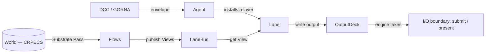

# Agents and Lanes

This page explains the single most-confused boundary in Khora: the line between a
**strategist** (an Agent) and an **executor** (a Lane). They are deliberately
different kinds of object with different rules, and keeping them straight is the
key to reading the per-frame descent. This is an explanation of *why* the split
exists and how data flows across it — for the steps to add either one, see
[How-to: add a lane](../how-to/add-a-lane.md) and
[How-to: add an agent](../how-to/add-an-agent.md); for the trait method tables,
the rustdoc on `khora_core::agent` and `khora_core::lane`.

---

## Two roles, one descent

The CLAD descent of a frame is `Control → Agent → Lane → Data`. The Control layer
(the DCC, via [GORNA](./gorna.md)) lends each agent an **envelope** — how much time
and memory it may use; the agent chooses how to do its work within it; the way it
chose — a lane at one level — does the work against data the Data layer has
projected. The two middle roles are not interchangeable:

- A **Lane** is a *hot-path worker*. It does one thing — draw the shadow maps,
  step physics once, mix one audio frame, lay out the interface — deterministically.
  It offers **levels** (the same work at several costs and qualities), prices each
  of them on the frame's inputs, and records at the one it is given. It decides
  *nothing*.
- A **family** groups the lanes that do the same job: they have the same outputs and
  run at the same place in the frame, so any of them can stand in for another. Each
  family is registered once (`register_agent!`), with its phase, its importance, its
  lanes and its default level.
- An **Agent** is the family's *strategist*. Every family gets the same one,
  `LaneAgent`, built from its registration: its **menu** is every level of every lane
  the device supports, each a **row**. It offers the menu to GORNA, receives its
  envelope, and chooses the row that fits. It decides *which* row runs, never how
  much time there is.

**The agent owns the choice. The lane owns the work.** A new subsystem is a new
family — lanes and a registration — never a new agent type. Every family the
engine ships, rendering and scripting included, is one: the only agent is the
`LaneAgent` each registration boots.

## Why agents are kept so thin

An agent implements **only** the `Agent` trait — no other methods, no
`start`/`stop`, no builders, no accessors. `LaneAgent` is built from a family's
registration by one free function, and its lanes are released by another. This is a
hard rule, and it is worth understanding the reasoning rather than treating it as
arbitrary:

- **One family per agent.** An agent has exactly one negotiation surface. The
  canonical example is shadows: the shadow maps and the main pass have different
  costs, different dependencies, and a different place in the frame, so shadows are
  a family of their own, not a second job of the renderer.
- **No per-frame state.** An agent does not buffer outputs, own a Flow, or
  accumulate work between frames. What it may hold is its strategy state — its
  lanes, the row it chose, its envelope — and *shared handles* it reads through.
  Anything that is a subsystem's own state belongs in `Runtime::services` or
  `Runtime::backends`, where the physics provider and the scripting runtime both
  live; anything measured per frame belongs in a shared slot the way
  `AgentFrameStatusMap` does. State on an agent is the first symptom of lane
  logic leaking upward — the old hand-written script agent carried an entire language runtime
  before this rule was applied to it, and what that cost was not correctness but
  reach: nothing else could see the live behaviors.
- **Strategist, never worker or controller.** An agent does not contain pipeline
  code (that is the lane's job) and does not decide global priorities (that is the
  DCC's job). It sits precisely in between.

The motive is legibility. Every agent in the workspace has the same shape, so the
boundary stays crisp and the slow drift toward god-object subsystems never starts.
If you find yourself adding a method to an agent struct, you are almost certainly
leaking lane work into the agent — the fix is to push it down into a lane.

A corollary worth stating: a subsystem that has *no strategies to negotiate* is not
an agent at all. ECS maintenance, asset loading, and serialization are **services**,
not agents, because there is nothing for GORNA to choose between. Reserve the agent
abstraction for subsystems that genuinely have competing performance strategies.

## What an agent declares

An agent answers two questions, and they are different questions.

`Agent::access()` is about the **`World` alone**:

| Variant | Meaning |
|---|---|
| `Exclusive` | takes `&mut World` — always a wave of its own |
| `SharedWorld` | reads `&World` |
| `Isolated` | does not touch the `World` at all, so it is eligible for the worker pool |

`Agent::contention()` is about **everything else**: the `OutputDeck` slots it
writes, and the `Runtime` resources, services and backends it reads or locks.
Two agents share a concurrent wave only when their contentions are disjoint;
reads do not conflict with reads.

The declaration is not on the honour system. An agent reaches shared state
through `EngineContext::resource` (reading) or `::locked` (taking a lock), and
both refuse what `contention()` did not declare — logging the refusal and
returning `None`.

**Declaring more than you touch is not harmless.** It silently serialises a wave
that could have run concurrently, and no test reddens. That is the failure mode
to watch for here: over-declaration fails in the direction of slowness, which
nothing catches automatically.

The rule this replaced was cruder — *at most one `SharedWorld` agent per wave* —
because such an agent "may write shared resources" and nothing could say which.
Now they say, so two of them may share a wave when their declarations do not
overlap. The parallelism was gained by removing a constraint, not by adding a
mechanism.

## Lanes are layers

Picture the frame as a sheet of paper with transparent sheets laid on it, each at its own height. An agent chooses a sheet — a lane — and lays it at its family's height. To change, it swaps the old sheet for the new one, at the same height. The frame itself just applies the sheets that lie there, frame after frame.

<figure class="kp-steps">

{{#include ../images/agents/layers.svg}}

<ol class="kp-steps-text">
<li><strong>A place for each family.</strong> Its <em>place</em> is fixed: its phase in the frame and, for what draws, its pass. On it lies one <em>layer</em>: one of its lanes, prepared at one level.</li>
<li><strong>The scheduler applies the layers.</strong> Every frame it runs each installed layer at its place, without calling or locking any agent. On a quiet frame an agent costs nothing.</li>
<li><strong>The layer wakes its agent.</strong> Each run prices itself. When the price no longer fits the envelope — or an allocation arrives, the lane fails, an input is refused — the layer leaves a <em>wake</em> for its agent.</li>
<li><strong>A new layer, prepared beside.</strong> Woken between the frame start and the frame's work, the agent chooses the row that fits and prepares a fresh layer of it — its pipelines, its buffers — while the old layer keeps running.</li>
<li><strong>The swap, at a frame start.</strong> At the next frame start the new layer takes the old one's place: the same place, the same outputs. No frame is ever left without a layer.</li>
<li><strong>Put aside, then released.</strong> The old layer is kept ready for three epochs, so going back to it prepares nothing; then it is released — at once if the envelope's memory cannot hold both.</li>
</ol>
</figure>

Concretely, the family's `Place` is shared between its agent and the scheduler. It
holds the layer installed, the one staged for the next frame start, the ones put
aside with the epochs they have left, the wakes gathered for the agent, and the
**terms** of the run — the epoch, the envelope, the time lent to a lane that takes a
budget, the fixed step. Its frame logic is written once, in `khora-core`, and the
scheduler and the tests run the same code.

A frame goes like this:

1. **Lending.** At the frame start, the allocation in force is lent to the agents
   that do not hold it yet; each one keeps it and leaves itself a wake.
2. **Swap.** Every place swaps its staged layer in.
3. **Event pass.** Once the frame's inputs are on the bus, every agent whose place
   holds a wake is woken: it takes in what its layer's last run found, prices its
   rows again when the prices may no longer hold, chooses, and stages a new layer —
   or reinstates one put aside — for the next frame start.
4. **Waves.** The layers run, grouped into waves by what the *installed* layers
   declare; each run reports.

The agent is woken for:

| Wake | What happened |
|---|---|
| `FirstFrame` | nothing is installed yet |
| `Allocated` | a new envelope, pin or allowed set was lent |
| `QuoteUnfit` | the running row's price stopped fitting the envelope |
| `QuoteDrift` | the running row's price moved more than 10 % from the last full quote |
| `QuoteAge` | the last full quote is older than a second |
| `TargetChanged` | the frame draws into another target |
| `LaneFailed` | the lane returned an error |
| `InputRefused(reason)` | an input was refused, and why |

The first report after a swap says how long the new layer took to prepare
(`Report.switch`): what a change of row costs, measured. A panic in a layer's run,
in a wake or at a frame start fails that family alone, for that frame; the wakes it
was handed are given back, so the next frame wakes the agent again.

## How a lane gets its data: the bus and the deck

A lane never reaches into the ECS `World` directly. This is the other half of the
discipline, and it is what makes lanes orthogonal — substitutable without touching
their neighbours. Lanes read and write through two tick-scoped, typed channels,
reached via the `LaneContext` the agent hands them:

- **The `LaneBus` — the read side.** The domain **Flow** layer is the *only*
  legitimate producer of the Views a lane consumes. During the Substrate Pass each
  Flow projects a typed View (`RenderWorld`, `ShadowView`, …) from the World and
  *publishes* it into the bus. A lane only ever *gets* a View by type from the bus;
  it cannot publish, and it cannot query the World behind the bus's back. The bus
  is constructed by the scheduler at frame start and dropped at frame end — outside
  lane execution it does not exist.
- **The `OutputDeck` — the write side.** The symmetric counterpart: a lane writes
  its typed output (recorded GPU command buffers, draw lists) into a slot on the
  deck. The engine drains specific types at the I/O boundary — submit, present —
  by *taking* them out. A lane produces into the deck; it does not perform the
  final I/O itself.

So the full data flow is: **World → Flow → LaneBus → Lane → OutputDeck → engine
I/O**, with the agent sitting above the lane choosing *which* row runs and the DCC
above the agent setting *how much* it may spend. Read-only Views in, typed outputs
out, nothing shared by long-lived reference. A lane can be removed, replaced, or
swapped for another strategy without disturbing any other lane, because everything
crosses the boundary as a typed value in the bus or the deck rather than as a
direct dependency between lanes.

That decoupling is the payoff of the whole arrangement. The `LitForwardLane` does
not depend on a `ShadowPassLane` *instance* — it depends on the shadow View being
present in the bus. The shadow lane can be rewritten, and as long as it still
publishes the same View type, the forward lane never notices.

## The life of a lane

A lane answers four questions, and the agent and its layer ask them:

- **`prepare`** — build what a level needs on the device (pipelines, buffers) for the
  frame's target. The agent calls it for a new layer, beside the installed one; a run
  prepares again only when the target changes.
- **`cost`** — the price of a level on this frame's inputs, per device. Every run
  prices every level of its lane, and quoting prices a lane without running it.
- **`record`** — do the work at one level and write the family's outputs.
- **`shutdown`** — release what `prepare` built, when a layer is released or the
  engine stops.

Everything a lane reads arrives through its typed inputs for that frame, and nothing
per-frame survives the call. Errors surface as a `LaneError` that wakes the agent,
which falls back to a cheaper row; a lane error never crashes the frame.

## Why this separation exists

Pulling the two roles apart buys three things the engine depends on:

1. **GORNA has something to negotiate.** Because a family's levels are its rows and
   its agent offers them, prices flow up to the DCC and envelopes flow back down —
   adaptation has a surface to act on. A monolithic "render system" would have
   nothing to choose between.
2. **The hot path stays decoupled from the cold path.** Envelopes are computed
   off-thread and lent at a frame start; layers run against Views the Flow layer
   already projected; agents are woken only by events. Nothing blocks on anything.
3. **Subsystems stay swappable.** Lanes communicate only through the bus and the
   deck, so a strategy can be added, removed, or replaced in isolation — which is
   exactly what an *adaptive* engine needs when it switches `LitForward` to
   `Forward+` mid-session because GORNA detected too many lights.

## Next steps

- [How-to: add a lane](../how-to/add-a-lane.md) — write a hot-path strategy.
- [How-to: add an agent](../how-to/add-an-agent.md) — register a new family.
- [GORNA](./gorna.md) — how envelopes reach agents and rows are chosen.
- [Data and the ECS](./ecs.md) — the World the Flow layer projects Views from.
- [Glossary](../reference/glossary.md) — Agent, Lane, LaneKind, LaneBus,
  OutputDeck, Flow, View.
