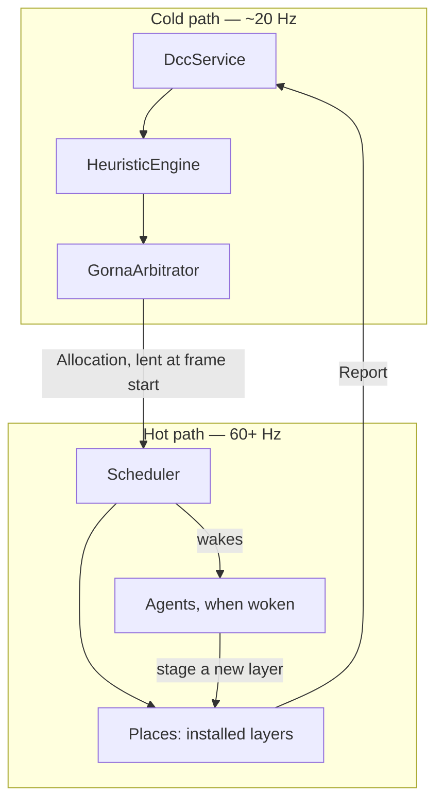

# GORNA: resource negotiation

A building site has one day of work to share out. The foreman asks every craftsman for a quote, hands each one an envelope of money, and each craftsman decides how to do the job with what is in it. In the evening, everyone says what they did and what it cost. GORNA is that dialogue, played between the parts of the engine for every frame's time.

**GORNA** — *Goal-Oriented Resource Negotiation and Allocation* — is the protocol
between the engine's **agents** (the parts that do the work: shadows, physics,
audio, the interface, …) and the **DCC**, the Dynamic Context Core that watches the
running game. The rule that shapes it fits in one line: **the DCC decides how much;
the agent decides how.**

This page explains why the engine negotiates at all, the dialogue message by
message, how the time is shared, how an agent chooses, and what happens when things
go wrong; the [formalisation](#formalisation) at the end states what it guarantees.
For pinning or bounding an agent in practice, see
[How-to: control GORNA adaptation](../how-to/control-gorna-adaptation.md); for
watching a live decision, [How-to: debug a frame](../how-to/debug-a-frame.md).

<figure class="kp-steps">

{{#include ../images/gorna/dialogue.svg}}

<ol class="kp-steps-text">
<li><strong>Every run, a report.</strong> Each agent says which way of working it ran, how long it took on each device, and how much of its work it got done.</li>
<li><strong>Something changed.</strong> The shadows took longer than their quote said. The DCC opens a new <em>epoch</em>, a numbered round of the dialogue.</li>
<li><strong>A call for offers.</strong> The DCC asks every agent switched on for an offer, and tells them the frame's target time.</li>
<li><strong>The offers.</strong> Each agent answers with its menu: every way it can do its work (a <em>row</em>), with its cost on each device, its quality, how sure the price is, and its floor — the cheapest row that keeps the game right.</li>
<li><strong>The envelopes.</strong> The DCC shares the frame's time out and publishes one <em>envelope</em> per agent: how much time and memory it may use. Never a row. Every agent receives it at the same next frame start.</li>
<li><strong>Each chooses.</strong> Every agent picks the best row whose price fits in its envelope. If nothing fits, it runs its floor and says so in its report.</li>
</ol>
</figure>

---

## Why negotiate at all

A traditional engine assigns budgets at compile time: physics gets 4 ms, rendering
gets 12 ms, audio gets the rest. Those numbers are correct on exactly one machine —
the developer's — and wrong everywhere else. A laptop on battery, a workstation, and
a Steam Deck do not share a frame budget, and the same machine does not share one
between a quiet menu and a crowded firefight.

GORNA replaces the fixed split with a negotiation that follows the game. Agents say
what they *can* do at several cost points; the DCC observes the running system,
applies a set of heuristics, and shares out a budget that reflects *this* hardware,
*this* scene, *this* moment. The result is one binary that adapts each frame to hold
the frame rate, instead of a binary tuned for one target.

A boundary worth stating up front: **only agents negotiate in GORNA.** The Data
layer does *not* compete here — it self-optimises its own memory layout
([AGDF](./agdf.md)), observed by the DCC but never driven by it, and never bids for
the frame budget. GORNA arbitrates strategy; AGDF arbitrates layout; they are
siblings, not the same auction.

## The four messages

One round of the dialogue is an **epoch**. Each epoch is one round trip: agents that
cooperate can say everything at once — their whole menu — so nothing needs to be
bid again.

| Message | From → to | Carries | When |
|---|---|---|---|
| `OfferRequest` | DCC → agent | the epoch, the frame's target time, the pressure, a deadline | when an epoch opens |
| `Offer` | agent → DCC | every row: its cost per device, its quality, its confidence (`Measured`, `Quoted`, `Assumed`); the floor; the row running; its health | in reply, from prices the agent already holds — no lane runs on the DCC's thread |
| `Allocation` | DCC → every agent | the epoch, why it opened, one **envelope** per agent (time per device, memory), a developer's pinned or allowed rows | published at once, lent at the next frame start |
| `Report` | agent → DCC | the row that ran, its time on each device, the share of its work done, its health, whether it was over budget or stalled, what a switch of row cost | after every run |

An epoch opens on a trigger: the first round, pressure from a heuristic (heat,
battery, memory), the cost model forecasting a breach, the frame-time controller
drifting, an agent arriving or leaving (a family switched on or off counts), a developer policy changing,
an agent stalled and unhealthy, overruns several frames in a row, a periodic
refresh — or an emergency (`Safety`). An epoch lasts at least a few ticks, except
for an emergency. The exhaustive field lists live in the rustdoc on
`khora_core::agent::gorna::protocol`.

## Who decides what

| Question | Who | How |
|---|---|---|
| How much time and memory? | DCC | one envelope per agent per epoch |
| When to renegotiate? | DCC | the triggers above, and the shortest length of an epoch |
| An emergency? | DCC | a `Safety` allocation: every envelope is its agent's floor, from the next frame start |
| Which way of working? | agent | the best row whose fresh price fits its envelope |
| What does it cost? | the agent's lanes | prices worked out on the frame's inputs, priced again when they change |
| What did I do? | agent | a report after every run |
| The developer's rules | DCC → agent | a cap is a ceiling on the envelope; `Manual` is a pinned row the agent is told; `Bounded` is a set of allowed rows |

## How the DCC shares the time

<figure class="kp-steps">

{{#include ../images/gorna/share.svg}}

<ol class="kp-steps-text">
<li><strong>The floors first.</strong> The DCC adds up every agent's floor on the frame's <em>critical path</em>: agents that run side by side, in one wave, count for the slowest of them; transfers between the processor and the graphics card count too. If the floors do not fit, it is an emergency.</li>
<li><strong>Then the upgrades.</strong> Of every possible step up — one agent moving to its next row — the DCC takes the one that gains the most quality for each microsecond, weighed by how important the agent is, and starts again.</li>
<li><strong>Passed over.</strong> An upgrade that no longer fits is skipped; a smaller one, for another agent, may still fit.</li>
<li><strong>The slack.</strong> What is left is not thrown away: 80 % of it is shared out to the envelopes, in proportion to what each was planned; 20 % stays back for spikes. An envelope is at least the price of the row the DCC planned for that agent, and has room to absorb a small rise.</li>
</ol>
</figure>

The DCC does plan one row per agent to size the envelopes, but it sends only the
envelope; the plan goes to the journal. Quality comes from each level's `Impact`
(none, minor, major → 1.0, 0.7, 0.4), so a family never has to invent a number.
The developer's rules are envelope shapes, applied to the plan: a pinned row is
planned as is, an allowed set limits the rows planned, a cap lowers the envelope.

## How an agent chooses

An agent holds, for every row of its menu, the last price it knows: its own run's
for the row running, a *quote* for the others (the lane prices itself on the frame's
inputs without running). With its envelope it picks:

1. among the rows whose price fits the envelope on every device, the one of least
   impact — the most faithful. Between equals, within one lane, the dearest level:
   more work done, more voices, more lights. Between two lanes, the cheapest: two
   lanes of equal impact give the same result, so the cheaper way wins — the forward
   renderer while the scene has few lights, Forward+ once it has more than the
   forward pass shades;
2. if none fits, its **floor**, and its report says it ran over budget — it never
   overruns in silence;
3. before anything is priced, the default level its registration names.

A developer's pin overrides the choice; an allowed set filters it. A row that failed
under the current envelope is passed by until the next allocation, and an agent
whose lane fails falls back to a cheaper row by itself.

## Lanes are layers

The agent chooses; it does not run its lane frame after frame. Each family has a
fixed **place** in the frame, and on it lies one **layer** — one of its lanes,
prepared at one level. The scheduler applies the installed layers every frame
without calling the agents, and an agent is woken only when its layer or an
allocation says it must choose again; a new layer is prepared beside the old one and
swapped in at a frame start, at the same place. [Agents and Lanes](./agents-and-lanes.md#lanes-are-layers)
tells that part of the story.

## When things go wrong

- **An agent busy at a frame start** (the DCC is reading its offer) is not waited
  for: it runs that frame on what it holds, and is handed what it missed at the next
  frame start.
- **An agent that arrives or leaves** — a family switched on or off, as the editor
  does with scripts, physics and audio at Play and Stop — opens an epoch
  (`AgentsChanged`). The switch lands at a frame boundary, and the DCC hears of it as
  `TelemetryEvent::ActivationChanged`: it keeps the families off in `Context.inactive`
  and clears its run reports. Only the active families are asked for offers and given
  envelopes.
- **An emergency** (heat, memory and overruns together: the *death spiral*) is an
  allocation like the others, marked `Safety`: each envelope is its agent's floor.
  It overrides developer control — safety wins — and it does not assume a row is
  called `LowPower`: every family has a floor.
- **Overruns several frames in a row**: the agent's layer wakes it at once, and it
  steps down by itself within its envelope; if the overruns go on, the DCC opens an
  epoch (`Overruns`). A stalled, unhealthy agent opens one too (`AgentStalled`).
- **A lane that fails or panics** fails its own family's run, never the frame: the
  agent falls back to a cheaper row, and a panic is caught, logged, and the agent
  is woken again on the next frame.
- **Stale reports** — a report made under an epoch that a later one already
  answered — are dropped, so an old overrun cannot reopen an epoch.
- **Replay**: arbitration is deterministic (no randomness, integer microseconds,
  ties broken by a total order), so the DCC can record its **decision journal** —
  each epoch's inputs, its allocation and its reasons — and replay it, one recorded
  allocation per frame start, asking no agent for an offer. A session's adaptation
  comes back exactly, for QA, lockstep and bug reproduction.

## The cost model and the frame governor

Two pieces turn measurements into the frame's target, and the division of labour
between them is the heart of the control loop.

The **heuristics** shape a single *frame-time target* rather than scaling the budget
directly. Thermal, battery, and engine-phase heuristics *relax* the target (a hot
device aims for 30 FPS rather than 60). They answer the question "what frame time
should we be aiming for?". The cost-model forecast can *tighten* what GORNA shares
pre-emptively: the target it allocates on, never the governor's setpoint, so one
overrun is not cut twice.

The actual `global_budget_multiplier` (the scalar applied to the frame target GORNA
shares) is driven by the **frame governor** (`khora_control::governor`), from the
frames' measured critical path: each frame's report says how long it kept each device
busy, waits for the display excluded, and the governor reads the slowest one. It is a
ratio law, the shape engines ship for dynamic resolution, not a PID: our loop moves by
whole rows, a frame or two late, on measurements with long hitches, and those three
things defeat a textbook PID. Each decision, the governor scales the multiplier by
`target / estimate`, with the target 10 % under the setpoint. Around it:

- **a band** under the target where it holds, and **a memory**: after lowering, it does
  not raise past the multiplier that ran over for five seconds. Together they stop the
  multiplier from cycling between two neighbouring rows;
- **fast down, slow up**: a lowering takes at most 30 % at once, a raise a quarter of
  the way;
- **decisions only on frames measured after the last change took effect**, or at once
  after three frames in a row over the setpoint;
- **hitches left out**: one frame twice the setpoint after normal ones is a load or a
  stall, nothing a row could fix;
- **no lever, no lowering**: when every agent already runs its floor, lowering further
  would sacrifice nothing and gain nothing, so it stops.

On top sits a **hard safety ceiling** that caps the published multiplier immediately
on critical thermal/battery or near-budget memory pressure: the governor regulates the
steady state, the ceiling handles emergencies. Every move of the published multiplier,
either way, opens an epoch (`Trigger::FrameGovernor`). Pressure drives the downgrades;
this is what drives *recovery*: once frames have room, the multiplier climbs, the
budgets are re-issued, and agents upgrade again instead of staying pinned at a degraded
strategy.

**Empirical cost calibration** closes the other gap. Quotes drift from reality per
machine and per scene. The DCC fits each agent's reports — `(workload, time)` — to an
empirical cost model (a constant factor times a complexity class `f(n)`, the shape a
query optimiser uses), and the round rescales every row of an offer so that the row
the agent runs costs what was measured. The rescale is clamped (to `[0.25, 4.0]`) so
one hitch cannot swing it by orders of magnitude, and the ordering of a menu is kept:
only its scale moves. An agent with no measurement yet keeps its quotes. This is the
"model proposes, measurement disposes" loop.

## The heuristics

The heuristic engine runs a battery of independent heuristics each tick, each one a
near-pure function of telemetry that emits a target adjustment or a recommendation.
Because they are independent, new heuristics grow the engine's adaptive intelligence
by accretion, without touching the existing ones.

| Heuristic | Reads | Effect |
|---|---|---|
| **Phase** | the current engine phase | relaxes or tightens the target for that phase |
| **Thermal** | GPU/CPU temperature | relaxes the target when hot; hard safety cap on critical |
| **Battery** | battery level + AC state | relaxes the target on low battery; hard cap on critical |
| **Frame time** | recent frame durations | tightens when frames run over target |
| **Stutter** | frame-time variance | flags inconsistent timing |
| **Trend** | frame-time slope | anticipates degradation before it becomes a stutter |
| **CPU pressure** | CPU utilisation | rebalances toward CPU-light rows |
| **GPU pressure** | GPU utilisation | rebalances toward GPU-light rows |
| **Death spiral** | consecutive over-budget frames | the `Safety` allocation until recovery |

One firm constraint runs through all of this: **GORNA can never force a phase.**
Adaptation changes the HOW, never the WHAT.

## AdaptationMode — the developer-control surface

GORNA is a partnership, not an autocracy. How much latitude it has over a given
agent is set per agent through **AdaptationMode** (via
`DccService::set_adaptation_mode`), and every mode is an envelope shape:

- **Learning** *(default)* — full negotiation.
- **Manual(row)** — the row is pinned: the DCC plans it, and the agent is told to
  run it whatever its envelope.
- **Stable** — the agent keeps its envelope while its row still fits it, so it does
  not flap from epoch to epoch; it still steps down under pressure.
- **Bounded { min, max }** — the rows planned and chosen are limited to a range.

A developer **hint** adds a weight (an agent made more or less important) or a cap (a
ceiling on its envelope). The `Safety` allocation can still give every agent its
floor in any mode — safety overrides developer control. The DCC can also **record
and replay** its decision journal (start/stop recording, load a journal to replay);
that is a capability of the DCC service, not an `AdaptationMode` variant.

## Cold path and hot path

The two paths touch only through the allocation channel and the reports, and the hot
path never blocks on the cold path: a live allocation published before a frame start
replaces any live one still waiting, and the frame lends whatever is newest; the
DCC's thread never touches an agent's envelope. Offers are read from prices the
agents already hold — no lane runs on the cold thread.

Within a phase the scheduler groups the work into **waves** and runs each wave
concurrently. Two layers share a wave only when their declared
[contentions](./agents-and-lanes.md) are disjoint. Because a wave is concurrent, its
cost is its **critical path** — the slowest member — not the sum of its members: the
scheduler publishes the wave plan and GORNA shares against `max` within a wave and
`sum` across waves. Over-declaring a contention is therefore not free: it serialises
a wave that could have run concurrently, and nothing reddens.

## Formalisation

*This part is for readers who want the guarantees stated precisely.*

**Notation.** *A* is the set of families switched on for the epoch (the [activation](../reference/glossary.md#activation)); only they are asked to offer and lent an envelope. The menu
of an agent *a* is a set of rows *r*, each with a cost *c*a,r ∈ ℕD
— integer microseconds on each device *d* — a memory *μ*a,r, and a quality
*q*a,r ∈ [0, 1] from its `Impact`. The floor of *a* is *f*a, its
importance *w*a. The scheduler's waves *W*1 … *W*k are
fixed for the epoch; the target is *T*, the memory available *M*.

**The cost of a frame** on a plan *x* (one row per agent) is its critical path:

> *C*(*x*) = Σj = 1…k maxa ∈ Wj maxd *c*a, x(a), d + transfers(*x*)

**The DCC's problem** is to maximise Σa *w*a *q*a, x(a)
subject to *C*(*x*) ≤ *T* and Σa *μ*a, x(a) ≤ *M*, with every
*x*(*a*) at least as good as *f*a. It is a multiple-choice knapsack on the
critical path, NP-hard in general. The Q-RAM greedy — floors first, then upgrades in
decreasing Δ(*w q*) / Δ*c* over each menu's convex hull — solves it near-optimally;
an exact solver stays the fallback for small menus. The envelope sent is
*b*a = *c*a, x∗(a) + *σ*a, where *σ*a is
*a*'s part of 80 % of the slack *T* − *C*(*x*∗), in proportion to
*c*a, x∗(a), device by device.

**The agent's choice** at frame *t*, from its fresh prices *ĉ*t:

> Let *F* be the rows with *ĉ*ta,r ≤ *b*a, and
> *F*∗ those of least impact in *F*. For each lane *ℓ*, let *r*ℓ
> be its dearest row in *F*∗. Then *r*t is the cheapest of the
> *r*ℓ (the first on a tie); *r*t = *f*a, flagged
> over budget, when *F* is empty.
>
> Within a lane, a dearer level of equal impact does more of the same work; across
> lanes, equal impact means the same result, so the cheaper lane leaves more of the
> envelope unspent. So the offer leaves out every row another lane's row
> *dominates* — no worse impact, no dearer on any device — since the agent never
> runs it while that row stands: the DCC sees only the steps an envelope can buy,
> and a dearer lane of equal quality is never taken for a lever.

**Propositions.**

- **(P-a) A frame fits when the prices are right.** If every *ĉ*t = *c*,
  then *C*(*r*t) ≤ *T*. *Proof.* Each agent runs a row costing at most
  *b*a. The share scales every planned time by one factor per device, so
  a wave's slowest member stays its slowest and the critical path grows by at most
  80 % of the slack: *C*(*r*t) ≤ *C*(*x*∗) + 0.8 (*T* − *C*(*x*∗)) ≤ *T*. ∎
- **(P-b) Every active agent can run.** Its floor is admitted, or the epoch is an
  emergency in which its envelope *is* its floor. *Proof.* The share admits every
  floor before any upgrade; when the floors do not fit, the allocation is `Safety`. ∎
- **(P-c) The choice can be replayed.** *r*t is a pure function of
  *b*a, the prices and the developer's rules: the same frame with the same
  prices chooses the same row. With integer costs and a total order on ties, the
  share is a pure function of its inputs too, which is what makes the journal
  replayable. ∎

When the prices are wrong — an agent under-quoted — P-a no longer holds for that
frame; the layer sees its own price leave the envelope on the run that overran, its
agent steps down from the next frame start, and the reserve (the 20 % kept back)
absorbs what is between.

**Layers.** *L*t(*a*) is the layer installed at *a*'s place during frame
*t*.

- *No frame without a layer:* a layer staged into an empty place is installed at
  once; afterwards *L*t(*a*) changes only at a frame start, from
  *L*t−1(*a*) to the staged layer.
- *The place is fixed:* every lane of a family has the family's outputs and phase, so
  a swap changes how the family works, never what it produces or when.
- *Bounded memory:* a layer put aside is released once *K* = 3 allocations have been
  lent, or as soon as the installed layer and the kept ones exceed the envelope's
  memory on a device — at every frame start, a place holds no kept layer the envelope
  cannot hold.
- *A quiet frame costs the agent nothing:* it is called only for a wake — its first
  frame, an allocation, a price that stops fitting or drifts by more than 10 %, a
  full quote older than one second, a new target, a lane error, a refused input.

**The cost of the protocol.** One round trip per epoch. The share costs
O(*L* log *L*), *L* being the number of rows of every menu together — a few dozen.
The choice costs O(|menu|) per agent, and only when the agent is woken: a quiet frame
adds no agent call.

## Next steps

- [How-to: control GORNA adaptation](../how-to/control-gorna-adaptation.md) — pin,
  bound, or free an agent.
- [How-to: debug a frame](../how-to/debug-a-frame.md) — watch a live GORNA decision.
- [Agents and Lanes](./agents-and-lanes.md) — what GORNA negotiates over, and lanes
  as layers.
- [AGDF](./agdf.md) — the layout adaptation the DCC observes but does not auction.
- [Glossary](../reference/glossary.md) — GORNA, DCC, epoch, envelope, AdaptationMode,
  cost model, frame governor, budget multiplier, death spiral.
