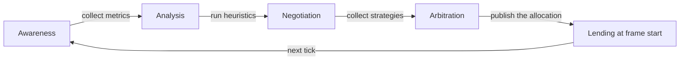
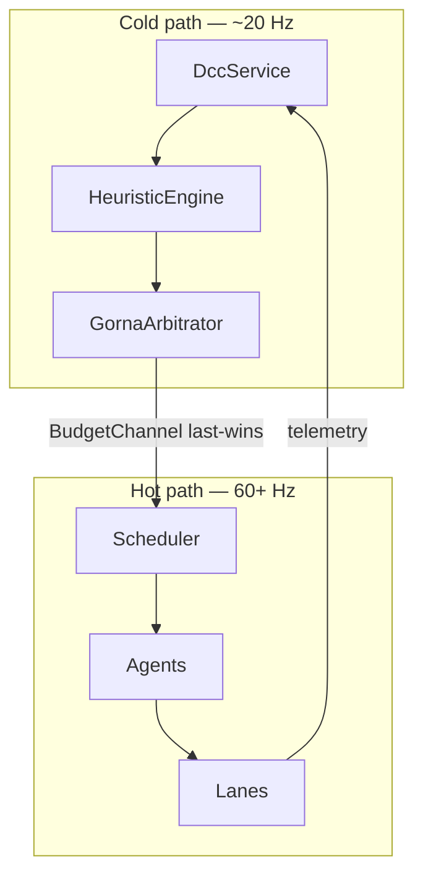

# GORNA: resource negotiation

**GORNA** — *Goal-Oriented Resource Negotiation and Allocation* — is the protocol
that lets the engine's agents and its central controller trade frame budgets in
real time. This page explains *why* the engine negotiates budgets at all, the shape
of the negotiation, and how the control loop closes. It is an explanation, not an
operator's manual — for pinning or bounding an agent in practice, see
[How-to: control GORNA adaptation](../how-to/control-gorna-adaptation.md), and for
watching a live decision, [How-to: debug a frame](../how-to/debug-a-frame.md).

---

## Why negotiate at all

A traditional engine assigns budgets at compile time: physics gets 4 ms, rendering
gets 12 ms, audio gets the rest. Those numbers are correct on exactly one machine —
the developer's — and wrong everywhere else. A laptop on battery, a workstation, and
a Steam Deck do not share a frame budget, and the same machine does not share one
between a quiet menu and a crowded firefight.

GORNA replaces the fixed split with a per-tick negotiation. Agents declare what they
*can* do at several cost points; the **DCC** (the Dynamic Context Core) observes the
running system, applies a set of heuristics, and hands back a budget that reflects
*this* hardware, *this* scene, *this* frame. The result is one binary that adapts
its strategy each tick to hold the frame rate, instead of a binary tuned for one
target.

A boundary worth stating up front: **only agents negotiate in GORNA.** There is one
negotiation surface per LaneKind, and that is it. The Data layer does *not* compete
here — it self-optimises its own memory layout ([AGDF](./agdf.md)), observed by the
DCC but never driven by it, and never bids for the frame budget. GORNA arbitrates
strategy; AGDF arbitrates layout; they are siblings, not the same auction.

## The negotiation, phase by phase

The loop runs on the cold path at roughly 20 Hz. The hot path never waits for it —
if a budget is late, the previous one simply stays in effect.

- **Awareness** gathers telemetry from agents and hardware monitors.
- **Analysis** runs the heuristic engine over that telemetry, shaping a single
  frame-time target.
- **Offers**: when an epoch opens, the DCC asks each agent active in the mode for
  an offer: every row it can run, with its cost per device, its quality and its
  floor.
- **Share**: the DCC admits every floor on the critical path, then gives the
  remaining time to the upgrades that gain the most quality per microsecond, and
  gives 80 % of what is left back as slack. Each agent receives an **envelope** —
  how much time and memory it may use — never a row.
- **Lending**: the DCC publishes the allocation; the scheduler lends it at its
  next frame start, to every agent at once, so no frame mixes two epochs. An
  agent busy at that moment keeps its envelope and is lent at the next frame
  start. The DCC's thread never touches an agent's envelope.
- **Choice**: each agent picks, every frame, the best row whose quote fits its
  envelope; nothing fits, it runs its floor and says so in its report.
- **Reports**: after each run the scheduler publishes the agent's report — the
  row, the time per device, the workload — which feeds the cost models and may
  open the next epoch (overruns in a row, a stalled agent).

The DCC decides *how much*; the agent decides *how*.
The request and budget shapes are intentionally narrow — time, memory, VRAM, and a
small extras map — so that adding a resource dimension is a considered change, not a
free-form bag each subsystem invents its own dialect for. The exhaustive field lists
live in the rustdoc on `khora_core::agent::gorna`.

## The cost model and the frame governor

Two pieces turn measurements into a budget, and the division of labour between them
is the heart of the current design.

The **heuristics** shape a single *frame-time target* rather than scaling the budget
directly. Thermal, battery, and engine-phase heuristics *relax* the target (a hot
device aims for 30 FPS rather than 60). They answer the question "what frame time
should we be aiming for?". The cost-model forecast can *tighten* what GORNA shares
pre-emptively: the target it allocates on, never the governor's setpoint, so one
overrun is not cut twice.

The actual `global_budget_multiplier` (the scalar applied to the frame target GORNA
shares) is driven by the **frame governor** (`khora_control::governor`), from the
frames' measured critical path: each frame's report says how long it kept each device
busy, waits for the display excluded, and the governor reads the slowest one. It is a
ratio law, the shape engines ship for dynamic resolution, not a PID: our loop moves by
whole rows, a frame or two late, on measurements with long hitches, and those three
things defeat a textbook PID. Each decision, the governor scales the multiplier by
`target / estimate`, with the target 10 % under the setpoint. Around it:

- **a band** under the target where it holds, and **a memory**: after lowering, it does
  not raise past the multiplier that ran over for five seconds. Together they stop the
  multiplier from cycling between two neighbouring rows;
- **fast down, slow up**: a lowering takes at most 30 % at once, a raise a quarter of
  the way;
- **decisions only on frames measured after the last change took effect**, or at once
  after three frames in a row over the setpoint;
- **hitches left out**: one frame twice the setpoint after normal ones is a load or a
  stall, nothing a row could fix;
- **no lever, no lowering**: when every agent already runs its floor, lowering further
  would sacrifice nothing and gain nothing, so it stops.

On top sits a **hard safety ceiling** that caps the published multiplier immediately
on critical thermal/battery or near-budget memory pressure: the governor regulates the
steady state, the ceiling handles emergencies. Every move of the published multiplier,
either way, opens an epoch (`Trigger::FrameGovernor`). Pressure drives the downgrades;
this is what drives *recovery*: once frames have room, the multiplier climbs, the
budgets are re-issued, and agents upgrade again instead of staying pinned at a degraded
strategy.

**Empirical cost calibration** closes the other gap. Agents quote *static* estimates
in their offers, but reality drifts from the quote per machine and per scene. The
DCC fits each agent's measured `(n, time)` samples to an empirical cost model (a
constant factor times a complexity class `f(n)`, the same shape a query optimiser
uses), and `GornaArbitrator::allocate` feeds those measured costs back into the
offers: every offered row is rescaled so the row the agent runs now
costs what was measured. The rescale factor is clamped (to
`[0.25, 4.0]`) so a single hitch or cold cache cannot swing the fit by orders of
magnitude, and the relative ordering of options is preserved — only the absolute
scale moves. The budget fitting therefore reasons about *measured milliseconds*, not
static worst-case quotes. An agent with no measurement yet (cold start) keeps its
quotes as-is. Together with the cost model's forecast — which can tighten the target
*before* a frame overruns — this is the "model proposes, measurement disposes" loop:
the controller acts ahead of a breach, and the measurements keep its arithmetic
honest.

## The heuristics

The heuristic engine runs a battery of independent heuristics each tick, each one a
near-pure function of telemetry that emits a target adjustment or a recommendation;
the arbitrator combines them. Because they are independent, new heuristics grow the
engine's adaptive intelligence by accretion, without touching the existing ones.

| Heuristic | Reads | Effect |
|---|---|---|
| **Phase** | the current engine phase | relaxes or tightens the target for that phase |
| **Thermal** | GPU/CPU temperature | relaxes the target when hot; hard safety cap on critical |
| **Battery** | battery level + AC state | relaxes the target on low battery; hard cap on critical |
| **Frame time** | recent frame durations | tightens when frames run over target |
| **Stutter** | frame-time variance | penalises strategies with inconsistent timing |
| **Trend** | frame-time slope | anticipates degradation before it becomes a stutter |
| **CPU pressure** | CPU utilisation | rebalances toward CPU-light strategies |
| **GPU pressure** | GPU utilisation | rebalances toward GPU-light strategies |
| **Death spiral** | consecutive over-budget frames | forces the cheapest strategy until recovery |

The death spiral is a first-class concept: when the engine cannot hold its frame
budget for several frames running, GORNA forces the cheapest strategy and monitors
for recovery, returning agents to negotiated strategies once the spiral breaks. It
overrides developer control — safety wins.

One firm constraint runs through all of this: **GORNA can never force a phase.** It
can suggest an *importance* change, but agents always control which phases they run
in. Adaptation changes the HOW, never the WHAT.

## AdaptationMode — the developer-control surface

GORNA is a partnership, not an autocracy. How much latitude it has over a given
agent is set per agent through **AdaptationMode** (via `DccService::set_adaptation_mode`,
the DCC being a registered service). There are four modes:

- **Learning** *(default)* — full negotiation; the DCC freely picks the best-fitting
  strategy each tick.
- **Manual(strategy)** — the agent is pinned; GORNA observes and reports but never
  switches it.
- **Stable** — GORNA may *downgrade* under pressure but never makes an opportunistic
  *upgrade*, so the strategy does not flap frame to frame.
- **Bounded { min, max }** — the chosen strategy is clamped to a range.

All four are enforced today. A death-spiral safety stop can still force the cheapest
strategy in any mode — safety overrides developer control. (A few finer modes —
calibration, spatial priority volumes, a spatial `PriorityVolume` constraint API —
remain on the roadmap; they are not part of `AdaptationMode`.)

Separately, the DCC can **record and replay** its decision trace. Arbitration is
deterministic (no RNG), so recording the strategy issued to each agent each tick and
replaying it reproduces a session's adaptation bit-for-bit — for QA, lockstep, and
bug reproduction. This is a *capability of the DCC service* (start/stop recording,
load a trace to replay), not an `AdaptationMode` variant, and it is implemented
today rather than planned.

## Cold path and hot path

The two paths touch only through the `BudgetChannel`, and the hot path never blocks
on the cold path.

Within a phase the scheduler groups agents into **waves** and runs each wave
concurrently — enabled by default (`set_parallel_execution(true)`). Two agents
share a wave only when their declared [contentions](./agents-and-lanes.md) are
disjoint; an `Exclusive` agent is a wave of its own.

Because a wave is concurrent, its cost is the **critical path** — the slowest
member — not the sum of its members. The budget fitting reflects that: the
scheduler publishes the wave plan and GORNA fits against `max` within a wave and
`sum` across waves. Over-declaring a contention is therefore not free: it
serialises a wave that could have run concurrently, and nothing reddens.

## Next steps

- [How-to: control GORNA adaptation](../how-to/control-gorna-adaptation.md) — pin,
  bound, or free an agent.
- [How-to: debug a frame](../how-to/debug-a-frame.md) — watch a live GORNA decision.
- [Agents and Lanes](./agents-and-lanes.md) — what GORNA negotiates over.
- [AGDF](./agdf.md) — the layout adaptation the DCC observes but does not auction.
- [Glossary](../reference/glossary.md) — GORNA, DCC, AdaptationMode, cost model, frame governor
  budget multiplier, death spiral.
