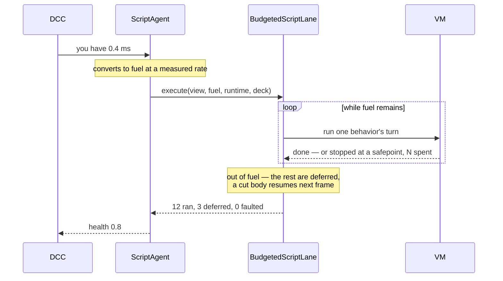

# Scripting (Ergon)

Ergon is Khora's gameplay language. It exists for one reason, and that reason is
the rest of this engine. This page explains how a script runs inside a frame,
how it stops and resumes, what a save keeps of it, and what happens to a script
that is part-way through something when its author edits it. For the language
itself — syntax, members, what compiles today — see the
[Ergon reference](../reference/ergon.md).

## Why not Lua, or C#, or WASM

Every subsystem in Khora can be told *"you have 0.4 ms this frame, work with
that"*. The renderer drops to a cheaper lane, shadows lose resolution, the audio
mixer sheds voices. [GORNA](./gorna.md) exists so those answers are negotiated
rather than guessed.

Gameplay was the one subsystem that could not answer. Hand a script a budget and
it will either finish or it will not, and if it does not, your options are to
let it overrun the frame or to kill it mid-decision. Neither is an answer.
Lua's debug hooks and Wasmtime's fuel can *interrupt* — but interruption is an
error path in both, and what a budget needs is for stopping to be **ordinary**.

So an Ergon script that runs out of budget stops at the next **safepoint** and
keeps the machine that stopped. Next frame resumes rather than restarts — and
because every safepoint has a name, the machine can even be resumed in code the
author edited since.



## A behavior at a glance

A script declares **behaviors**: state and logic attached to an entity.

```text
event Damaged(int amount);
event Look;
event Spotted(Entity foe);

behavior Guard {
    int health = 100;

    void OnSpawn() { Log("on duty"); }

    on Damaged(int amount) {
        health -= amount;
        if (health <= 0) { this.Despawn(); }
    }

    state Patrol {
        every 2s { this.Raise(Look()); }
        on Spotted(Entity foe) { become Chase(foe); }
    }

    state Chase(Entity foe) {
        async void Attack() {
            await 0.5s;           // wind up
            foe.Raise(Damaged(10));
        }
    }
}
```

Fields hold what the guard *is*; lifecycle members (`OnSpawn`, `Update`, …)
are called by the engine; `on` handlers answer events, each one declared with
`event` so that a raise and every handler are checked against it; `every` and `after` are
schedules; `state` confines data and members to a phase of the behavior's life;
`async` members may `await` a duration. The [reference](../reference/ergon.md)
lists every construct and what compiles today.

## A system at a glance

A behavior is one entity's logic over time. A **system** is one rule over every
entity a query matches:

```text
component Health { float current = 100.0; float max = 100.0; }
component Regen  { float rate = 2.0; }
component Shield { float bonus = 1.0; }
component Player { int team = 0; }
component Dead   { float since = 0.0; }

system Regeneration {
    float healed = 0.0;

    void Update(float dt) {
        foreach (Entity e, ref Health h, Regen r, Shield? s) with Player without Dead {
            float rate = r.rate;
            if (var shield = s) { rate += shield.bonus; }
            float before = h.current;
            h.current = Min(h.max, h.current + rate * dt);
            healed += h.current - before;
            if (h.current >= h.max) { e.Remove(Regen); }
        }
    }

    every 10s { Log("regenerating"); }
}
```

A system is **a behavior with no subject**. It has fields, `Update`, `every`
and `after`, methods, `OnLoad` and `OnResumeFailed` — and nothing that would need
an entity of its own. The checker refuses, at the construct and saying why:

| Refused in a system | Because |
|---|---|
| `this`, `Position()`, a free function that reads `Position()` | there is no entity it is attached to — its entities are the rows of its queries |
| `state`, `become` | what one entity is doing is a behavior's state |
| `on` handlers | an event is aimed at an entity |
| `async`, `await` | a wait would be one entity's time; a system's time is `every` and `after` |
| `OnSpawn`, `OnDespawn` | a system starts with the game, not with an entity |
| attributes | `[Critical]`, `[Budget(…)]`, `[Rate(…)]` schedule it like a behavior; never `[Domain(…)]` — its fields live in the `Script` domain |

### Its one entity

Under the hood a system runs **as a behavior instance** — so its fields, its
timers, its share of fuel, a body cut short, a fault, a hot reload and a game
save are the behaviors' machinery, not a second one. An instance needs an
entity, and nobody authors a system's: while the game plays, the
`script_systems` data system keeps **one entity per system**, known by a named
identity — `PersistentId::named("system:Regeneration")` — and holding the
system's component (its fields) and its state companion
`Regeneration#state`. Both are `Runtime` and resumable:

- **No scene holds it**, whatever the encoding — and Play's snapshot neither, so
  Stop takes it away. An authored entity that happens to hold a system's
  component is still the author's.
- **A game save keeps it**, with its fields and timers; a load finds the entity
  of that name again instead of making a second.
- **No script reaches it.** `Regeneration` is not a component a script may
  `Get`, `Set`, `Add`, `Remove`, `Has` or query: any other holder would be a
  second instance, run every frame beside the first. A system's fields are its
  own, named directly.
- It exists while gameplay runs, and goes when no script declares the system
  any more. A system imported by several modules runs once a frame — from the
  module that declares it.

## One turn

Each frame, each behavior gets a **turn**. A turn runs its steps in a fixed
order, each only when it applies:

<div class="kp-figure-frame">

{{#include ../images/scripting/turn.svg}}

</div>

The order is the guarantee. `OnLoad` runs before anything can observe a restored
instance. A body still under way — waiting on an `await`, or cut short by the
budget — resumes before anything new starts, so a behavior never runs two
answers to "what am I doing" at once; and while it is still waiting, nothing
else of that behavior runs this frame.

### Turns in one order

The frame runs behaviors and systems in **one list**: by module path, then by
where each is written in its module — a system declared between two behaviors
takes its turn between theirs — and a behavior's instances in entity order. It
is the order a reader can check by reading the files; nothing reorders it yet.
It matters because a script reads what the scripts before it wrote this frame
([below](#a-script-never-writes-the-world)).

## Stopping is ordinary

Fuel is charged per instruction but **checked only at safepoints**: the start of
a statement, the head of a loop, a function's entry, just past a call's return.
A run that has spent its fuel goes on to the next one and stops there; what it
spent past the budget is reported as an overdraft, never hidden. Every loop's
back edge lands on a safepoint, so the stretch between two of them is
straight-line code: the compiler measures the worst one, and a run never
overdraws more than that.

<div class="kp-figure-frame">

{{#include ../images/scripting/sites.svg}}

</div>

Stopping only there is what keeps a stopped machine small and meaningful. At a
statement's start no half-evaluated expression is live — the machine is its
locals and a position. And every such position, and every place a frame stands
after an `await` or a call, is a **site** with a name the compiler derives from
the source: the kind of each enclosing statement and a short hash of what it
says. Those names are what let a machine survive an edit (below).

### Text outlives the stop

Text a body builds — `"hp " + name`, a name an engine function returned, an
event's argument — lives in frame memory, emptied every frame. A stopped body
keeps it anyway: on stopping, the machine copies the text its registers name
into itself, and when it resumes puts it back where running code reads it. A
field and a state's data keep text by value for the same reason, so `become
Chase("x" + name)` stores the text, not a reference to it. Frame memory is one
for the whole run and counts the frames, so text kept past its frame by any
other route fails to read — it never reads what a later frame put in its
place.

### A body that never finishes

Fuel bounds a frame, not a body. A loop with no `await` — `while (true) { … }`
in `Update` — is cut by fuel, resumes next frame, is cut again, and never
finishes; and while it stands there nothing else of its behavior runs. The
**watchdog** bounds the body. Per instance, it counts the game time the body
under way has spent *running* without finishing:

- a frame in which the body ran — it started or was resumed, spent fuel and was
  cut — adds that frame's delta, and so does a frame its behavior sits out
  repaying fuel *that body* overdrew, counted as it passes: that budget was
  spent in advance. A paused game, at a delta of zero, adds nothing;
- a frame it waits on an `await` adds nothing — that is waiting, not running —
  and neither does a frame its instance did not run for any other reason: a
  frame with no fuel for scripts, another instance's debt, disabled, or not
  playing;
- resuming from an `await` starts the count again from zero; finishing ends it.

Every body counts — `Update`, a timer, an `async` member, `OnSpawn`, `OnLoad`,
`OnResumeFailed` — in behaviors and systems alike. At `WATCHDOG_WARN`, **10 s**,
the body is reported once — a warning naming the entity, the behavior, the
member and the site it stands at, and an entry in the lane's report. At
`WATCHDOG_FAULT`, **60 s**, it **faults** like any fault: the body is dropped
— a timer's waits its interval again, and a body a hook stood in front of is
next — the instance disabled, and the fault recorded in its state companion
under the code it ran, so an edit to its module re-enables it. The count is
saved with the body under way, so a save and a load do not reset it, and a hot
reload carries it, whatever the edit made of where the body stood.

## Degrading defers whole behaviors

A budget that will not cover every behavior forces a choice. The lane could give
each behavior a smaller slice — every guard thinks a little less, uniformly. Or
it could give each its full turn, in order, until the budget runs out, and defer
the rest.

**It defers.** A behavior thinned every frame decides from a partial read of the
world, and a hundred of those is a hundred subtly wrong decisions that no one can
debug. A deferred behavior acts a frame late, which gameplay absorbs — a frame
late *is* what a frame is. The one behavior the budget runs out *inside* stops at
a safepoint and finishes its turn next frame, from where it stopped.

Who is deferred is fair, and what the author declared bends it:

- each behavior that can spend has an **equal share** of the frame's fuel, in its
  fixed order — what one does not spend passes on; a behavior that overdraws at a
  safepoint repays it from its next shares; each starts from a **cursor**, the
  first of its instances the last frame had no fuel for, so none is left out
  every frame; a turn is not started on less than half of what one costs;
- `[Critical]` claims first, `[Budget(d)]` caps, `[Rate(f)]` thins out turns
  ([Scheduling](../reference/ergon.md#scheduling));
- **no time is lost**: a turn is handed all the time since the instance's last,
  so a timer, a wait or an `Update` integrating `dt` keeps time through the
  frames it sat out. Adapting the budget changes *when* a behavior runs, never
  how much game time it sees.

This is why `report_status` reports the share of behaviors that got their turn
rather than a simple success flag: an agent claiming perfect health while half
its behaviors were deferred would tell the DCC nothing was wrong at exactly the
moment something was.

## A fixed clock

`FixedUpdate(float dt)` runs once per tick of the game's fixed clock the frame
took — 1/60 s each, whatever precision physics sub-steps at — `dt` the tick,
inside the behavior's turn: after its timers, before its events and `Update`.
It is a clock, not a callback interleaved with physics: every call of a frame
sees the frame's view of the world, and its writes reach physics next frame.
Steps the fuel does not reach are owed, each with the step it was taken at, and
run first next turn; the count a game integrates does not depend on the budget.

## Scripts run only while the game runs

The script agent is registered for one engine mode: `Playing`. In the editor,
**editing** is the editor's own mode, and no script runs while you arrange a
scene; Play switches to `Playing`, and **pause** keeps it — scripts still run, at
a delta of zero.

<div class="kp-figure-frame">

{{#include ../images/editor/play-modes.svg}}

</div>

Play does not resume anything: every scripted entity arrives fresh and runs
`OnSpawn`. Stop puts the scene back as it was. A shipped game starts in the mode
its `EngineApp::initial_mode` says — `Playing` unless it says otherwise.

Not running is not absent. The editor mounts the open project's scripts when it
opens it, and a save recompiles the module while you edit as while you play.
Scripts live in one folder, `assets/scripts/`: a module is named by its path
from there, and imports are written from there. An `.erg` saved anywhere else
is not a script — not at startup, not on a save — and says so. What
a script **declares** registers at once — the Inspector lists the project's
components and behaviors, and edits them as typed fields (a `Duration` in
seconds, an `Angle` in degrees) — and what it **compiled to** waits for Play.
What goes wrong is not left in the log: an `.erg` outside `scripts/`, compile
errors, a component two modules declare, a component no module declares any more, a faulted instance and a body
the watchdog warns about all land in one place, `ScriptProblems`, which the
editor shows as its **Problems** tab ([Editor — Scripts](../reference/editor.md#07--scripts)).

## A script never writes the world

Effects are queued as `WorldCommand`s and applied by a data system during
[Maintenance](./the-frame.md). Nothing a script does reaches the ECS while it
runs.

That constraint is not bureaucracy — it is what buys the parallelism. Because
the script lane touches no `World`, its agent declares `AgentAccess::Isolated`
and can share a wave with other world-free agents. The rule and the performance
are the same fact.

The commands apply in the order they were queued. Many rows of one component —
a system sweeping ten thousand healths — travel as **one** command, a column
write: the component and its fields are resolved once, the rows are written page
by page in memory order, and a row whose entity is gone is skipped and counted
rather than failing the rest. On 10,000 rows it costs about a sixth of the same
writes queued one by one (`cargo bench -p khora-data --bench data --
RigidBody.mass`).

Two writes landing on the same thing in one frame are reported in debug builds —
the last one wins. They are told apart **per field**: two scripts writing
`current` and `max` of one `Health` compose and are not reported; two writing
`current` are, and so is an add or a removal of `Health` beside any write to it.

A behavior is a component, so another script writes it like one —
`target.Set(Guard { speed: 2.0 })` — and reads it with `Get` and `Has`; a
behavior changes its own fields by assigning them, never by a `Set` of itself.
Its turn and the scripts around it write in **one order**, the order the frame
ran them in. A `Set` of a guard's field queued before the guard's turn is read
by that turn — `speed += 1` builds on it, and nothing is lost. A `Set` queued
after the turn is written after it and wins: the field the turn changed is
the `Set`'s, and the turn's write is reported as lost, like any other. A `Set` a
turn queues of its own fields — through an entity that happens to be its own —
was not read by it and loses to what the turn wrote, reported as well; a
component added or removed in the frame is another instance's, and keeps
nothing the turn wrote of the old one. A field the turn only read is not a write
of it, and each lost write is reported once, with every write that meant to set
the field counted.

## Queries and sweeps

`foreach (…)` with no `in` is a **query**: its bindings name what every row
holds, and its body runs once per row — a **sweep**.

```text
foreach (Entity e, ref Health h, Regen r, Shield? s) with Player without Dead { … }
```

| Part | A row… |
|---|---|
| `Entity e` | binds the row's entity — anywhere in the list, once |
| `Regen r` | holds a `Regen`; `r` is a copy of it |
| `Shield? s` | may hold a `Shield`; `s` is a copy, or `null` — it never filters |
| `ref Health h` | holds a `Health`; `h` is a copy written back at the row's end — in a system only |
| `with Player` | holds a `Player`, not read |
| `without Dead` | holds no `Dead` |

**Outside a system, a query is read-only.** A behavior may sweep — a census, a
search for the nearest foe — but binds without `ref`, and writes another
entity's component with `e.Set(…)`, as any script does: writing rows in place is
what a system is for. A system in turn may read a behavior's component in a
query, never `ref` it: a behavior's fields are written by its own turn or by a
`Set`, and its turn builds on the `Set`s queued before it — a column write it
never read would break the frame's [one write order](#a-script-never-writes-the-world).
Every component a query names, filters included, joins the program's reads, so
the frame projects it.

<div class="kp-figure-frame">

{{#include ../images/scripting/sweep.svg}}

</div>

### The rows are taken once

When the sweep starts, the query takes its rows: the entities holding every
component bound without `?` and every `with`, and none of the `without`, **in
entity order**, from the frame's working set — what the frame projected, with the
adds, removals and writes the frame's scripts have queued so far. The list is
held by the machine, so a structural change the body makes — `e.Remove(Regen)`,
`e.Add(Dead { })` — is a command, and leaves the sweep alone. Each row is
**checked again** when it is reached: one an earlier row's body took out of the
query is skipped. An entity spawned this frame is not among the rows — it exists
from the frame's end; a despawned one keeps its rows until then, as it keeps its
components. Taking the rows visits the holders of the rarest component the query
requires, so it costs what the query matches, not what the scene holds. A query
run again — inside a loop, or next frame — takes its rows again.

### `ref`: written where the row ends

A `ref` binding is a copy like the others, except that its fields may be
assigned — `h.current += 1.0` — and are written back; the binding itself is
never reassigned. Where the row ends — after the body's last statement, where a
`continue` lands, before a `break` or a `return` leaves the sweep — the fields
that **differ** from the row as it was read are written:

- **into the working set, at once** — a later row, a later sweep of the same
  run, and every script after it in the frame read the new value;
- **into the run's pending batch** for that component and that set of fields.

A batch leaves as **one column write** (`WriteColumn`) — early, before any later
`Set`, `Add` or `Remove` of that component in the run, and in any case when the
run stops, however it stops: finished, cut by fuel, faulted. No batch crosses a
frame or a save, and the run's writes reach the `World` in the order they were
made: ten thousand rows writing `current` are one command, and a run writing
`Health`, then `Regen`, then `Health` again leaves each field as it last wrote
it. A row left as it was read writes nothing; a field the row did not change
keeps whatever another script set this frame. Rows that change another set of
fields start a batch of their own, and a fault keeps the rows ended before it.

### A sweep short of fuel

A sweep stops like any body — at a safepoint: the head of the next row, or a
statement inside one, even part-way through a row. The rows it ended leave with
the run; next frame the machine resumes exactly where it stopped, on its row,
over the list it took, every later row checked against the working set of the
frame it is reached in. Each row is written once. The body keeps the `dt` it was
called with, the delta of the frame its pass began in. The list and the position
are locals of the frame, so a game save freezes a sweep part-way like any body,
and an edit [rebuilds](#a-body-part-way-through-in-tiers) it at its site.

GORNA prices a system by its rows: a system is one instance however many rows it
sweeps, so the script agent estimates 2 µs per instance plus 0.2 µs per row the
frame's queries took the frame before.

## An event is never delivered in the frame it was raised

One behavior tells another something; the other hears it next frame.

Handling an event where it was raised opens a cascade with no bound — behavior A
raises to B, B raises to C, C raises back to A — and a budget that cannot bound
the work is not a budget. The one-frame delay is the bound.

Two queues feed one delivery:

| Source | Route |
|---|---|
| Behavior → behavior | waits on the `ScriptRuntime`, never leaves scripting |
| Engine → behavior (a collision) | a bounded `Channel<ScriptEvent>` the engine fills and the lane drains |

They stay apart on purpose. Script-to-script mail routed through a shared
resource would cost two frames of latency and a deck slot nothing else reads.

<div class="kp-figure-frame">

{{#include ../images/scripting/events.svg}}

</div>

An event is **declared** (`event Damaged(int amount);`), and the declaration is
what both ends answer to: the compiler refuses a raise of an event that does
not exist or with the wrong payload, and a handler of one, instead of a
delivery that quietly finds nobody or faults its receiver. What the compiler
cannot see — the engine's mail, or mail queued before a reload changed the
event — is checked again at delivery, and a payload that does not fit is
dropped and reported, the receiver left running. Each program finds its
handlers in a table it builds once from its declarations; the entity's state
picks among them as it is delivered.

## Saved mid-sentence

A behavior is a component. `Guard` — declared by its script, attached by adding
it to an entity — holds the behavior's fields: what the author set, and what the
game makes of them as it plays. A scene holds it as authored. Beside it, its
**state companion** `Guard#state` is **runtime and resumable**: what the engine
keeps to resume the running behavior. A scene never holds it; a
[game save](./saves.md) does, with the fields the game changed:

| A save keeps | So that, after a load… |
|---|---|
| the fields the game changed, by name — a `null` too (`Guard`) | the guard has the health it had; `best = null` loads as `null`, not as its default |
| the current state and its data | it is still chasing whom it was chasing |
| each timer's remaining time | `every 2s` fires when it would have |
| the body under way, frozen | an attack half-way through its wind-up finishes it |
| whether it has spawned | `OnSpawn` never runs twice |
| a fault, and the code it faulted under | a broken behavior stays off until its code changes |

A frozen body is written in names, not positions: its functions by name, its
text by value — a literal and text built while running alike — each frame by the
site it stands at, with its locals by name.
That is what lets a save made today load into the script as it is next month.

After a restore, `OnLoad` runs first; the restored body waits behind it.

A system is saved the same way, on [its one entity](#its-one-entity): the save
holds that entity, its fields and its companion — its timers, a sweep it was
part-way through, a fault. A scene never does.

## Edits while running

Hot-reload replaces a module's program while the game runs. Two things must
survive it: what each instance *is*, and what each instance is *doing*.

A module can also go: its file deleted, its folder moved out of `scripts/`,
its project closed. Its program leaves with it — nothing keeps running code
whose file is gone — and every instance of it stops, says so in Problems, and
keeps its fields. When the module comes back, by a move or an undo, its
instances carry those fields across as for any edit.

### Fields, by name

An author edits a guard's `Update` while ten guards are patrolling. The ten
should still be where they were, with the health they had — restarting them
would make the feature useless for exactly the thing it is for.

Fields are carried across a recompile and matched **by name**. A slot means
nothing across a rebuild: inserting one field at the top shifts every slot after
it, and a positional carry-over would silently move one guard's health into
another's ammo. A field that was renamed keeps no value, and the engine says so
in a warning rather than letting the author find out from whatever the guard
does next. A field the edit retyped keeps its value only if the new type can
hold it: `int? best` holding `null`, edited to `int best = 4`, starts at `4` —
never at a value no author could write. A load into edited code follows the same
rule.

How the inspector shows a field — its `[Range]`, `[Tooltip]`, `[Header]` — is
not the field: it is the editor's, read by nothing a script runs. An edit that
changes only those reaches the inspector at the next reload and leaves every row
as it was; a range bounds what the inspector edits, never what a script writes,
so a guard whose script pushes its health past the range keeps that health.

What the guard is *doing* crosses the same way: the state it is in by name, that
state's data by slot name, each countdown by its schedule's identity. A chasing
guard is still chasing after the edit, with what is left of its timers; a state
or schedule the edit removed is dropped, a new one starts fresh, and a datum new
to the current state starts at its own declared default.

The World and the program move **in the same frame**. An edit's new fields are
laid out in the World at the start of a frame; whatever compiled the program
announces what it reads, so the frame projects those components and the lane
installs the new program before any turn — no turn runs the old code over rows
already laid out for the new. When a program does have to wait a frame for what
it reads, its module's instances take no turn that frame: their events wait,
and an entity arriving then spawns under the new code. A behavior moved to
another module is carried there at its next turn, by the same rules, and an
instance carried while starved of fuel still has its record — what a save
reads — brought up to the new code that frame.

A system is carried by the same rules: its fields by name, a sweep cut
part-way rebuilt at its site in the edited body. An edit may also change what a
name *is*. A behavior turned into a system runs once a frame on the system's
entity; the entities that held the behavior keep their rows as data and run
nothing, and an authored one stays in the scene. A system turned back into a
behavior gives up its entity, and the behavior's holders run again from their
rows. A system renamed is a new system: the old name's entity goes, and the new
one starts from its defaults.

### A body part-way through, in tiers

A guard is half-way through `Attack`, stopped at its `await`, when the author
edits the script. What the frozen machine holds is a position in the old code.
Resuming it blindly in the new code would run whatever now sits at that
position; abandoning it would lose the attack every time anyone touches the
file. Khora does neither. It takes the body back in the best of five tiers:

<div class="kp-figure-frame">

{{#include ../images/scripting/resume-tiers.svg}}

</div>

- **Exact** and **unchanged** rest on fingerprints. Each function's fingerprint
  is a stable hash of its code with everything it names — a callee, a literal, a
  field — hashed by name, so moving another function or adding a field leaves
  it alone. Renaming a local changes no code at all: it resumes exactly.
- **Rebuilt** rests on site names. A statement's name comes from what it says,
  and an `if` or a loop from its header only, so adding a line above the
  `await`, or editing the loop body around it, leaves the `await`'s site where
  it was. Each frame is laid out again at its site in the new code, every local
  moved to its new register by name, declaring block and type.
- **Restarted** reruns the member with the arguments it was first given — not
  what its parameters held when it stopped, since a body may reassign them. What
  ran before the cut may run again; the author edited the code it was running.
- **Abandoned** tells the behavior, which can repair what the lost body was in
  the middle of:

```text
void OnResumeFailed(string member) {
    if (member == "Chase.Attack") { become Patrol; }
}
```

The same tiers apply to a game save loaded into edited code, and every resume
below *exact* is listed in the lane's report — which body, which tier.

A call with named arguments keeps this promise too. Its arguments run in the
order they are written, each into a register of its own, and only then are
placed in the order the callee declares its parameters. A turn stopped between
two of them holds what it evaluated whatever that order is, so an edit that
reorders the callee's parameters cannot hand one value to the other's name. A
call that names nothing compiles exactly as it always did.

<div class="kp-figure-frame">

{{#include ../images/scripting/named-arguments.svg}}

</div>

## Who owns what

The split follows [CLAD](./clad.md) exactly, and it did not always:

| Piece | Where | Why |
|---|---|---|
| The language and VM | `khora-script` | Depends on `khora-core` and the macros only, so the compiler and VM are testable without booting an engine |
| The scripting world (programs, live instances, pending mail, last report, measured rate) | `Runtime::services`, as `Arc<Mutex<ScriptRuntime>>` | It is subsystem state, not strategy state — the same place the physics provider lives |
| The work (reloads, delivery, running behaviors and systems, measuring) | `BudgetedScriptLane` | Lanes execute |
| A system's one entity | the `script_systems` data system (`khora-data`) | Structure is the data layer's; a lane never spawns |
| Choosing a lane for a budget | `ScriptAgent` | Agents are strategists and hold nothing else |

The agent used to own all of it. What that cost was not correctness but reach:
nothing else could see the live behaviors, because they were a private field of
a strategist.

## Adding a type to the language

Two places, not eight: a row in the `script_value_table!` X-macro
(`khora-core::script`), and a line of the `ergon_type!` declaration in
`khora-script::native::engine_types`. Exposing `Vec3` once cost an
`impl ScriptType`, a hand-written constructor, and an arm in each of four
converters across three crates — and the copies diverged, so
a raise carrying a `Vec3` produced a value the delivery side did not know, the
lane treated that as a fault, and the target behavior was disabled for good.

It is deliberately a **declaration and not an attribute**. An attribute belongs
on the item it describes, and these types live in `khora-core`, which must not
carry scripting annotations. More decisively, a `ScriptType` needs a matching
`Value` variant, and those come from the table — so a game cannot expose a type
of its own this way whatever the syntax. What is being written down is not "this
struct is scriptable" but "this table row is reachable from a script".

If a change needs a new arm in four files, the table is being bypassed.

---

*Next: the [Ergon reference](../reference/ergon.md) for the language,
[Agents and Lanes](./agents-and-lanes.md) for the strategist/executor split this
page assumes, or [GORNA](./gorna.md) for how the 0.4 ms is decided.*
