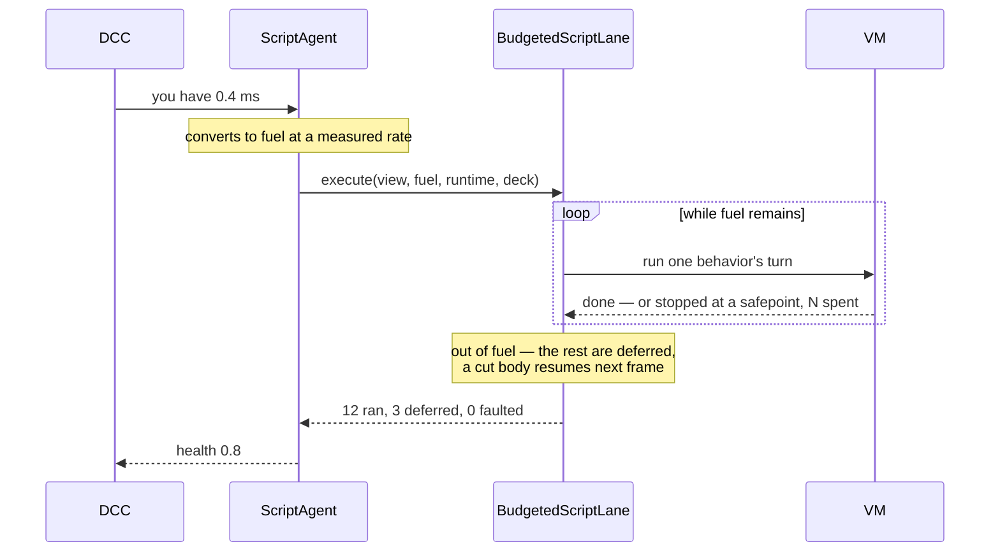

# Under the hood

For readers who want the reasons: why Khora has a language of its own rather than Lua or C#, which part of the engine owns what, and how a type becomes usable from a script.

## Why a language of its own

Every subsystem in Khora can be told *"you have 0.4 ms this frame, work with
that"*. The renderer drops to a cheaper lane, shadows lose resolution, the audio
mixer sheds voices. [GORNA](../gorna.md) exists so those answers are negotiated
rather than guessed.

Gameplay was the one subsystem that could not answer. Hand a script a budget and
it will either finish or it will not, and if it does not, your options are to
let it overrun the frame or to kill it mid-decision. Neither is an answer.
Lua's debug hooks and Wasmtime's fuel can *interrupt* — but interruption is an
error path in both, and what a budget needs is for stopping to be **ordinary**.

So an Ergon script that runs out of budget stops at the next **safepoint** and
keeps the machine that stopped. Next frame resumes rather than restarts — and
because every safepoint has a name, the machine can even be resumed in code the
author edited since.

## Who owns what

The split follows [CLAD](../clad.md) exactly, and it did not always:

| Piece | Where | Why |
|---|---|---|
| The language and VM | `khora-script` | Depends on `khora-core` and the macros only, so the compiler and VM are testable without booting an engine |
| The scripting world (programs, live instances, pending mail, last report, measured rate) | `Runtime::services`, as `Arc<Mutex<ScriptRuntime>>` | It is subsystem state, not strategy state — the same place the physics provider lives |
| The work (reloads, delivery, running behaviors and systems, measuring) | `BudgetedScriptLane` | Lanes execute |
| A system's one entity | the `script_systems` data system (`khora-data`) | Structure is the data layer's; a lane never spawns |
| Choosing a lane for a budget | `ScriptAgent` | Agents are strategists and hold nothing else |

The agent used to own all of it. What that cost was not correctness but reach:
nothing else could see the live behaviors, because they were a private field of
a strategist.

## Adding a type to the language

Two places, not eight: a row in the `script_value_table!` X-macro
(`khora-core::script`), and a line of the `ergon_type!` declaration in
`khora-script::native::engine_types`. Exposing `Vec3` once cost an
`impl ScriptType`, a hand-written constructor, and an arm in each of four
converters across three crates — and the copies diverged, so
a raise carrying a `Vec3` produced a value the delivery side did not know, the
lane treated that as a fault, and the target behavior was disabled for good.

It is deliberately a **declaration and not an attribute**. An attribute belongs
on the item it describes, and these types live in `khora-core`, which must not
carry scripting annotations. More decisively, a `ScriptType` needs a matching
`Value` variant, and those come from the table — so a game cannot expose a type
of its own this way whatever the syntax. What is being written down is not "this
struct is scriptable" but "this table row is reachable from a script".

If a change needs a new arm in four files, the table is being bypassed.

---

*Back to [Scripting](./index.md), or on to the [Ergon reference](../../reference/ergon.md), [Agents and Lanes](../agents-and-lanes.md) for the strategist/executor split, and [GORNA](../gorna.md) for how a frame's budget is decided.*
