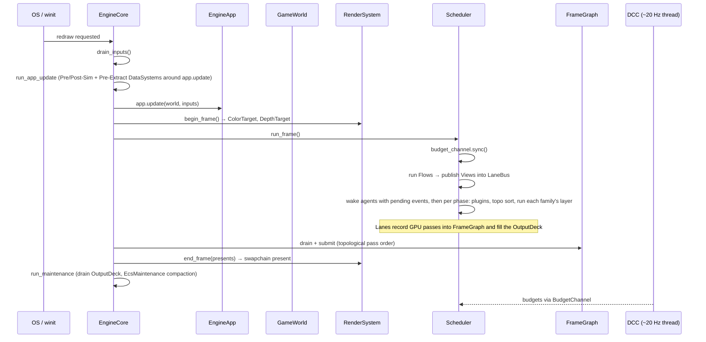

# The frame

How Khora turns the [CLAD](./clad.md) layering into motion — the per-frame
descent, the Substrate Pass, and the fixed-timestep model that keeps the
simulation deterministic.

---

## Two clocks, one channel

Khora has two clocks. The **hot path** runs every frame on the main thread, at
60 Hz or higher, and must never block. The **cold path** runs at ~20 Hz on a
background thread, watches what just happened, and decides what should happen
next. They communicate through a single channel: budgets flow from the cold path
to the hot path; telemetry flows back.



The cold path is the subject of [The big idea](./saa.md) and the GORNA
reference. This page is about the hot path — the six stages a frame walks
through, and the timing model underneath them.

## Startup, once

Before the first frame, the engine boots through the SDK entry point. It builds
the window hidden, constructs your app, and runs your bootstrap closure. In that
closure the app registers what it needs from the engine: the renderer, the
pipeline system, physics, layout, audio. Then the engine registers its services
and the DCC, calls `setup` once so you can spawn initial entities and cache
service handles, then `provide`, and registers the families. The first frame is painted, then the window
is shown. Nothing in `setup` is ever re-run; after it, the engine enters the
frame loop and stays there.

The engine runs first; the slow work comes after, as ordinary frames. An app
does not index a project, load a scene or compile scripts inside `setup`.
Instead it files each of them and keeps the ticket it gets back:

- the project index goes to the `IndexHub`;
- a scene goes to the `SceneLoadHub`;
- scripts go through `scripts::mount`, which returns a ticket.

The `loading` family does that work off the frame, within the budget the DCC
lends it, and each result lands at a later frame's boundary.

An app that must know when its startup is over waits on those tickets
through the runtime's `Readiness`. It can also take a `hold` while it files
work in steps. The engine calls `startup_ready` once, on the frame where
everything has landed, or after 60 s, with the late tickets reported as
problems. The editor's loading film is painted by those first frames and fades
on `startup_ready`. `run_default` loads a game's default scene and scripts the
same way, with no film.

One exception keeps `setup` simple for a game built in code: scripts mounted
in the bootstrap closure, before the boot, are compiled by the boot. Their
declarations are then registered before `setup`, which can attach a behaviour
by name. The sandbox works this way.

The details of bootstrapping an app are a how-to, not a concept — see the
[SDK quickstart how-to](../how-to/spawn-and-transform.md) for the actual steps.

## The six-stage descent

Each frame runs six stages in order. Every stage is a public method on the
engine core, so drivers (the editor's overlay and shell) can interleave hooks
between them:

```
1. drain_inputs        ← Read the queued InputEvents (not taken), tick telemetry
2. run_app_update      ← Substrate invariants (Pre/Post-Sim, Pre-Extract) around app.update
3. begin_render_frame  ← RenderSystem::begin_frame, swapchain acquire
4. run_scheduler       ← Substrate Pass (Flows publish Views) + phase-by-phase layer runs
5. end_render_frame    ← submit FrameGraph + RenderSystem::end_frame
6. run_maintenance     ← Maintenance DataSystems drain the OutputDeck; EcsMaintenance compacts
```

A few stages reward a closer look, because they are where the architecture's
discipline shows.

**Stage 2 — `run_app_update`** opens with the frame boundary — the families on and
off settled, the scheduler's frame start, the `Boundary` systems, and `startup_ready`
the first frame that finds startup over — then runs the data layer's invariants
*around* your game logic: pre-simulation systems (input-driven mutations the app will see),
then `app.update`, then post-simulation systems (hierarchy fix-ups such as
transform propagation), then pre-extract systems (GPU mesh sync). Notice what is
*not* here: scene projection. That happens in Stage 4.

**Stage 4 — `run_scheduler`** is the heart of the descent. It runs in two parts.
First the **Substrate Pass** runs every registered projection
[**Flow**](../reference/glossary.md), publishing each domain's typed View into
the [**`LaneBus`**](../reference/glossary.md) for lanes to consume. Then the
Scheduler runs every active execution phase in order — `INIT`, `OBSERVE`,
`TRANSFORM`, `MUTATE`, `OUTPUT`, `FINALIZE` — syncing budgets from the DCC,
running plugin hooks, topologically sorting the phase's families by their hard
dependencies, and running each family's installed **layer** — one of its lanes at
one level — at its place, in waves formed from what the layers contend for. An
agent is not called on a quiet frame: it is woken, before the waves, only for an
event (a new envelope, a price that stopped fitting, a failed lane), and then
chooses a row and prepares a new layer. This is the `Control → Agent → Lane → Data`
descent made concrete: the Scheduler is Control, the agents choose the layers it
runs, lanes read the Views the Substrate just published.

**Stage 6 — `run_maintenance`** is where the data layer does its own
housekeeping. The maintenance systems drain the
[**`OutputDeck`**](../reference/glossary.md) the lanes filled — audio and physics
write-backs land on ECS components here — and the ECS maintenance pass compacts
storage pages and prunes orphaned data. This pass is *Data-owned and
self-budgeted*: it is not negotiated with the DCC. It is the home of the data
layer's self-optimization, the same "Data adapts itself" principle from
[CLAD](./clad.md).

> **Two output channels.** Lanes feed two sinks. The `FrameGraph` carries
> recorded GPU render passes, drained and submitted in Stage 5. The typed
> `OutputDeck` carries cross-domain results (audio, physics, …), drained by
> maintenance systems in Stage 6. The *inputs* to lanes are the typed Views the
> projection Flows publish into the `LaneBus` in Stage 4.

The six stages are the single most important sequence in Khora. Everything
performance-critical happens here, in this order. To watch a real frame walk
through them, see [Debug a frame](../how-to/debug-a-frame.md).

## The Substrate Pass

The **Substrate** is the data layer's per-tick self-presentation: the invariants
that keep the World consistent (Stage 2) and the projection Flows that publish
read-only Views for the lanes (Stage 4). The Scheduler *invokes* the Substrate
because it owns the tick ordering, but it does not decide *how* the data is laid
out — that remains the data layer's own concern.

The crucial property: Flows are **read-only projectors**. A Flow reads the World
and publishes a typed View; it never mutates game state and never changes which
components an entity has. This is the frame-level expression of *adapt the HOW,
never the WHAT*. Lanes consume those Views from the bus rather than querying the
World directly — which is what lets the data layer change its internal
representation freely without any lane noticing.

## Fixed-timestep simulation and render interpolation

Rendering runs at the display's variable rate, but the **simulation** must
advance in fixed increments to stay frame-rate independent and deterministic. A
physics step that depended on a variable frame delta would produce different
results on a 30 Hz machine and a 144 Hz machine — unacceptable for physics,
replays, or networked play. Khora reconciles the two with a single time
**accumulator**, owned by the Scheduler.

The model, per frame:

1. **Measure and clamp.** Take the real wall-clock delta since the previous
   frame and clamp it to `MAX_FRAME_DELTA_SECONDS` (0.25 s). A longer real gap —
   a debugger break, an asset hitch, a window drag — is truncated so the
   accumulator never demands an unbounded catch-up. This is the classic
   *spiral-of-death* guard.
2. **Scale, then accumulate.** Multiply the clamped delta by `Time::scale` and
   add it to the accumulator. See *[The simulation clock](#the-simulation-clock)*
   below.
3. **Consume whole ticks.** The game's fixed tick `fixed_delta`
   (`DEFAULT_FIXED_DELTA_SECONDS`, 1/60 s) is the one clock game code sees:
   `ticks = floor(accumulator / fixed_delta)`, capped at `MAX_SIM_STEPS` (5 ticks,
   83 ms of simulated time). The remainder carries over to the next frame.
4. **Derive alpha.** The leftover fraction — `remainder / fixed_delta`, always in
   `[0, 1)` — becomes the render `interpolation_alpha`.
5. **Sub-step the fixed families.** A family whose place holds a fixed step
   (`Place::fixed_step`) — physics, at the game's `physics.step` — gets exactly the
   simulated time the ticks advanced, `ticks × fixed_delta`, in a second
   accumulator, and its layer runs once per whole step of its own size that fits
   (a fixed-update sub-loop, each iteration a full run of the layer). Then the
   regular phase loop runs **once**, excluding those families so they are not
   stepped twice. So physics integrates *N* discrete
   sub-steps while the render fires exactly once.

See *[Precision is not time](#precision-is-not-time)* below for why the two
clocks are separate.

### The simulation clock

The delta that reaches the accumulator is the wall-clock one **times
`Time::scale`**. At `0.0` the accumulator never fills, so `steps` is zero: no
body integrates, no script timer counts down, and rendering carries on at real
time because it reads `interpolation_alpha`, not this. Between the two it is
slow motion; above it, fast forward.

That one number is how the editor pauses a game. `PlayMode` stays inside
`khora-editor` and never becomes engine vocabulary — the editor writes a
scale, exactly as a pause menu or a cutscene would, and is one caller among
several rather than a case the engine knows about. `Time::scale` is private and reachable only through `set_scale`, which
clamps at zero: running a solver backwards is not a slower forward, and every
integrator here assumes time moves one way.

The scale says whether time passes; it does not say *which families run*.
That is the **activation**, the `Arc<Activation>` resource the SDK publishes
before the app's `setup` (`khora_core::agent::Activation`). It knows every
registered family — every `register_agent!` registration, scripting
included — and every family starts on. `activate(family)` and `deactivate(family)` are
requests; a family it does not know is refused (`UnknownFamily`) and logged.

The requests land at the **frame boundary**: the SDK calls `settle()` once per
frame, after the app's `before_frame` and before the first DataSystem phase.
Every phase, every Flow, the scheduler and the DCC then see one state; a
request made later in the frame counts from the next one. A family off is not
asked to offer, is lent nothing, and does not run. The DataSystems and Flows
that do its work are skipped too, by their **role**: each one declares
`Role::Upkeep` (a data invariant, run every frame) or `Role::Serves(family)`
(skipped while the family is off). On its first run after a skip, a system
sees `SystemContext.resumed`, and a Flow's `select` sees
`FlowContext { resumed: true }`. Mail sent to a family while it is off is
dropped at the boundary if its mailbox says `BetweenSessions::Drop`.

The editor switches the families in `before_frame`
(`khora-editor/src/commands/transport.rs`). Editing has scripting
(`khora_core::script::SCRIPT`), physics (`khora_core::physics::PHYSICS`) and
audio (`khora_core::audio::AUDIO`) off, at a scale of 1: nothing steps
because nothing that steps runs. Play switches the three on. Pause leaves them
on and sets the scale to 0: a paused game is still the game, its scripts run
at a delta of zero. A game without an editor keeps every family on unless it
switches one off.

Applied once, in the scheduler. An agent deciding for itself whether time
passes would be a dozen places to disagree about what "paused" means.

```mermaid
sequenceDiagram
    participant Loop as Frame
    participant Acc as sim_accumulator
    participant Sim as Fixed families (physics)
    participant Render as Render (once/frame)

    Loop->>Acc: += min(real_dt, 0.25 s) × scale
    Note over Acc: ticks = floor(acc / fixed_delta), capped at 5
    Acc->>Sim: + ticks × fixed_delta of simulated time
    Note over Sim: sub-steps = floor(sim_acc / physics step)
    loop sub-steps times
        Sim->>Sim: step(physics step)
    end
    Acc->>Loop: alpha = remainder / fixed_delta  (in [0, 1))
    Loop->>Render: render once, blend by alpha
```

The step arithmetic is small and pure — its essence is:

```rust
let acc = accumulator + dt;            // dt already clamped to 0.25 s, scaled
let ticks = (acc / fixed_delta).floor();    // whole game ticks this frame
// ... capped at MAX_SIM_STEPS, the excess dropped so the accumulator stays bounded
let alpha = (remainder / fixed_delta).clamp(0.0, 1.0);   // render blend factor

let sim_acc = sim_accumulator + ticks * fixed_delta;   // exactly the ticks' time
let sub_steps = (sim_acc / physics_step).floor();      // the rest carries over
```

**The determinism guarantee** is the payoff: the *same total elapsed time
produces the same number of sim steps regardless of frame cadence*. A 144 Hz
burst and a 30 Hz stutter that span the same wall-clock interval run identical
step counts. Game logic that must be deterministic therefore never sees a
variable step. Variable-rate game code instead reads the real delta; render
smoothing reads the interpolation alpha.

On saturation — when more than `MAX_SIM_STEPS` ticks would be required — the
excess time is dropped rather than queued. Under sustained overload (below 12
frames a second) the simulation runs in *slow motion* rather than freezing in an
ever-deepening catch-up, and the accumulator stays bounded. This is a deliberate
trade: a brief slowdown is recoverable; a spiral of death is not. The cap counts
ticks, so it is the same 83 ms whatever step physics runs at.

### Precision is not time

The physics step is a game setting — `physics.step` in the game's settings
(`khora_core::physics::PhysicsSettings`, 1/60 s by default) — and never a GORNA
lever: the simulation's result depends on it, so no budget may change it. It is a
choice of **precision**: how finely a second is cut, never how many seconds pass.
The simulated time is decided once, by the ticks; the physics sub-clock only
divides it. Whatever the step, a body falls the same distance in a second of real
time and stays within one physics step of the game's clock (the leftover carries
over to the next frame).

The two clocks are kept apart on purpose. If the physics step *were* the clock,
a script's `FixedUpdate` would run 30, 60 or 120 times a second depending on the
physics precision, and the catch-up cap — counted in steps — would be 166 ms of
time at one step and 42 ms at another, so a slow machine would slow the game
down only under the precise step. Both would tie the game's time to how finely
physics cuts it. Bevy (`Time<Fixed>` + physics substeps), Unity
(`fixedDeltaTime` as a project setting, a catch-up guard in seconds) and Godot
(`physics_ticks_per_second`) draw the same line: the game owns the tick,
precision subdivides it.

All of this timing state lives in one place — the engine's
[**`Time`**](../reference/glossary.md) resource (`khora_core::time::Time`),
republished fresh into the runtime each frame before the render phase reads it. It
carries the real `delta_seconds`, the `fixed_delta_seconds`, the
`interpolation_alpha`, the frame's `fixed_steps`, and a monotonic `frame`
counter.

`fixed_steps` is what a script's `FixedUpdate` is called for: the game ticks the
frame took, at `fixed_delta_seconds` each — never the physics sub-steps, so a
script's cadence does not follow the physics step. A game with no physics
has the same fixed clock, and a paused one takes no tick. Scripts run once per frame, after
the fixed sub-loop, on one view of the world: their `FixedUpdate` is a fixed
clock, not interleaved with physics, and what it writes reaches physics next
frame.

### Why interpolation is render-only

Because the simulation steps at a fixed cadence but the screen refreshes at a
different one, the most recent simulated pose rarely lands exactly on a frame
boundary. Rendering the raw current pose would judder. Instead the render path
blends the *previous* and *current* poses by `interpolation_alpha`, producing
smooth motion at any refresh rate.

Here is the architecturally important part: the previous-pose store for
interpolation is an engine-internal **resource**
(`khora_core::interpolation::TransformInterpolation`), **not** an ECS component.
A post-simulation system snapshots each simulated body's world transform into
that store before propagation overwrites it; the render path reads it to blend.

This is *adapt the HOW, never the WHAT* in its purest form. Interpolation is a
render representation: it carries no game meaning, so it must never appear as a
component in the editor inspector or in a saved scene. Only simulated entities
(those carrying a rigid body) are snapshotted; everything else simply renders at
its current transform. The store is pruned each pass so a despawned body leaves
no stale entry. Keeping it out of the ECS is what guarantees the smoothing can
never leak into simulation semantics — a saved scene is identical whether or not
the renderer ever interpolated it.

## Next steps

- **[Debug a frame](../how-to/debug-a-frame.md)** — walk a live frame through the
  six stages and inspect a GORNA decision.
- **[The big idea](./saa.md)** — the cold path that feeds budgets into Stage 4,
  and the philosophy the frame serves.
- **[Glossary](../reference/glossary.md)** — every proprietary term in one place.
