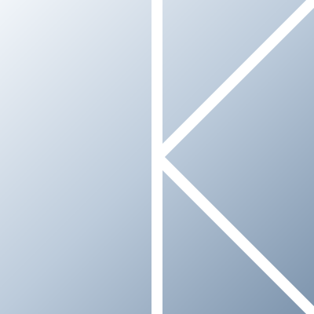
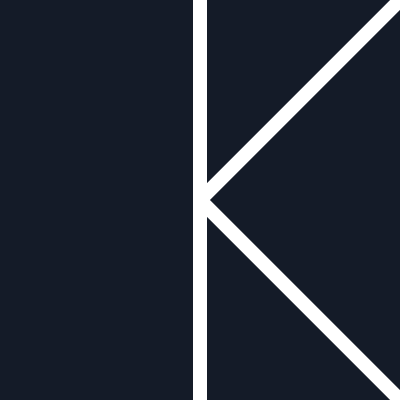
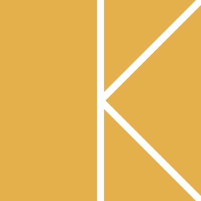
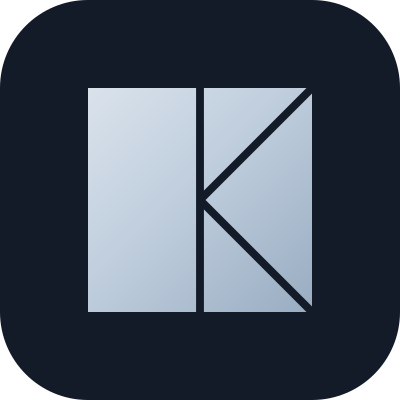

# Khora Editor — Design Document

**An editor that thinks.**

A hi-fidelity design system for the Khora Engine editor — a 2D/3D Rust engine built on a self-optimizing Symbiotic Adaptive Architecture. This document captures the visual language, architectural choices, and panel-by-panel rationale behind the design.

- Document — Khora Editor Design v1.0
- Status — Hi-fi mockup
- Date — May 2026

---

## Contents

1. Design principles
2. Brand & identity
3. Color system
4. Typography
5. Layout & spine
6. Panels
7. Viewport
8. Command palette
9. Control Plane
10. Interactions
11. Decisions log
12. Open questions

---

## 01 — Design principles

The five rules everything else descends from.

### 1. The work is the hero
Chrome retreats. Toolbars are thin, panels are quiet, the viewport breathes. The user's scene, code, or canvas is always the loudest thing on screen.

### 2. The engine has a mind — show it
Khora is built on a self-optimizing architecture (GORNA). The editor must surface that intelligence — telemetry as ambient signal, not a separate dashboard. The user should *feel* the engine thinking.

### 3. Density without density anxiety
Engine editors fail by hiding everything in nested menus or by drowning the user in chips. We use a **Spine** (mode rail) and **Pills** (compact groups) so dense information stays scannable.

### 4. Mode-first, not panel-first
Unity and Unreal let you arrange panels freely — and most users keep the default forever. We commit to opinionated layouts per Mode. Two workspaces ship today — **Scene** (3D dock) and **Control Plane** (DCC / agents) — with further authoring workspaces (2D canvas, node graph, animation, shader graph) added as they are built. Power users can still customize, but the default is excellent.

### 5. Calm color, loud signal
The base palette is near-monochrome (deep blue-black + warm silver). Color is reserved for **state** — gold for the active selection, green for healthy telemetry, amber for warnings. When something is colorful, it matters.

---

## 02 — Brand & identity

### The mark
A square, cut along a K. One cut runs straight down through the centre, O; two more run at 45° from O to the two right-hand corners. The square falls into a rectangle and three right-angled triangles — and the pieces never move. **The K is the empty gap between them**: one fine cut, 14 on a side of 400, the same width at every size.

Khora is named after the *chôra*, Plato's receptacle: the place that holds whatever comes to be, without being any of it. The mark is that place — a plain square that becomes a letter only where it is open. And its left half is a door: in motion, it swings open onto the light behind.

<figure class="kp-steps">

{{#include ../images/brand/the-sign.svg}}

<ol class="kp-steps-text">
<li><strong>A square.</strong> Nothing yet: the place that receives.</li>
<li><strong>One cut, through the centre.</strong> A vertical through O splits it into two equal halves.</li>
<li><strong>Two cuts at 45°.</strong> From O to the two right-hand corners: three triangles on the right, a rectangle on the left.</li>
<li><strong>The K is the gap.</strong> The pieces stay where they are; the letter is the space between them, drawn in gold here.</li>
<li><strong>The left half is a door.</strong> It opens onto the light that was behind the square all along.</li>
</ol>
</figure>

### Colours
The sign has one shape and four finishes. Gold is never its everyday colour: gold means *now*, and in the mark it is the light behind the door.

| Finish | Use | File |
|---|---|---|
| Polished silver — `#f1f5f9` → `#bccbdb` → `#7d94ad`, top-left to bottom-right | on dark surfaces: the editor, the hub, these docs | [`khora-sign.svg`](../logos/khora-sign.svg) |
| Navy — `#141b28` | on light surfaces, print | [`khora-sign-navy.svg`](../logos/khora-sign-navy.svg) |
| Gold — `#e3b04b` | one-colour uses on dark: a stamp, a splash | [`khora-sign-gold.svg`](../logos/khora-sign-gold.svg) |
| Silver on a navy tile | app icon, avatar, favicon | [`khora-icon.svg`](../logos/khora-icon.svg) |

### The name
**KHORA** is set in Archivo Expanded, weight 300, spaced wide (0.5 em). Two lockups, both kept:

- **Beside** — the sign, then KHORA with `ENGINE · ΧΩΡΑ` under it in IBM Plex Mono. For headers, title bars, anything wider than tall.
- **Below** — the sign, KHORA under it, a short gold rule, then `ΧΩΡΑ`. For splash screens, covers, anything centred.

KHORA

ENGINE · ΧΩΡΑ

KHORA

ΧΩΡΑ

At 16 px the two 45° cuts do not survive the pixel grid: a favicon or a tray icon needs the sign redrawn by hand, pixel by pixel. Until then, the icon tile stands in.

### In motion
The sign has two films, and both tell the same story: a light that was always behind the square.

- **The sign** — the frame is traced, the silver square appears whole; a round hole opens at the joint, exactly as wide as the cut, and the cuts run out of it to the edges. The pieces then trade space in opposed pairs — left against right, top against bottom — so the K keeps its width, a negotiation that never overruns, while a gold glow pulses behind the cut. The left rectangle swings open like a door onto a square of light, and shuts; the light goes out, and only then do the cuts close back into O.
- **The door** — the plate stands on a floor, seen in perspective, whole. A hole opens at the joint, light wells up inside it, then runs to the edges and draws the K, casting it in gold on the floor. Someone behind kicks the door open, stands in the light, and walks back into it. The light breathes in — dust is drawn into the doorway and the draught pulls the door half shut, twice — and breathes out. The door closes, the light goes out, the pieces close up, and the plate is whole again.

The first film is short enough for a loading screen; the second is for a splash or a page header. With reduced motion, each shows one still frame.

### Where the mark lives
- **Title bar** — small, in the brand pill, before `KhoraEngine`
- **Spine top** — slightly larger, anchoring the mode rail
- **Empty viewport** — giant watermark at 5% opacity behind the grid
- **Command palette** — replaces the search-icon glyph
- **Status bar** — small leading glyph; the cut glows faintly gold while async work runs

### Mood
Not industrial. Not playful. *Instrumental* — like a workshop where every tool has earned its hook on the wall.

| | | | |
|---|---|---|---|
| **deep** | **precise** | **awake** | **honest** |
| Surface | Type | Motion | Voice |

---

## 03 — Color system

The palette is designed in **OKLCH** for perceptual uniformity. Hues hold their identity across light/dark, and our gold stays gold across alpha tints.

### Foundation — the deep field
The shell sits in a narrow band of blue-black, never pure black. Pure black creates harsh contrast that fights with code syntax colors and 3D viewport content.

| Role | OKLCH | Use |
|---|---|---|
| **bg-0** Void | `oklch(0.14 0.020 265)` | App background — rarely seen directly |
| **bg-1** Shell | `oklch(0.16 0.022 265)` | Panel surfaces, title bar |
| **bg-2** Raised | `oklch(0.18 0.022 265)` | Cards, hover states |
| **bg-3** Elevated | `oklch(0.21 0.024 265)` | Modals, command palette |

### Foreground — warm silver
Text and icons sit in a warm, slightly desaturated silver. Cooler grays read as clinical; warmer grays as cheap. We split the difference and bias warm.

### Accents — three signals only
Three accents, one job each — the theme's `accent_a`, `accent_b` and
`accent_c` slots, filled from `pal` in `khora-tool-ui/src/brand.rs`:

- **Violet** `#ad9bf6` (`accent_a`, the default `ACCENT`) — custom and extension agents; in use today for the folder a dragged asset would drop into, and the Transform phase in the Control Plane
- **Cyan** `#73ccea` (`accent_b`) — information and links: the console's info rows, the CPU meter, the Observe phase
- **Gold** `#e7be68` (`accent_c`) — **selection and the active state only**: the active mode on the Spine, the selected row of the command palette and the hierarchy, the row the Control Plane runs

Green, amber and red are not accents but the **status** colours (`success`,
`warning`, `error`): healthy telemetry, a warning, an error.

> **Color is a load-bearing element.** Gold means *now*. Silver means *noticed*. Everything else is structure.

### In code
Each token is converted once from its OKLCH value to a constant in
`khora-tool-ui/src/brand.rs` (`pal`, the dark palette; the light one beside
it), the conversion recorded in `design-reference/TOKENS.md`. The constants
are **sRGB** floats in `0..1` — the byte divided by 255, not linear light, even
though their type is named `LinearRgba`. The egui backend hands them over
unconverted, each channel times 255 into a `Color32`. A widget never reads
`pal`: it reads the semantic slots of the `UiTheme` it is given (below), so a
tool re-themes by passing another theme.

---

## 04 — Typography

One family for words, one for code — the logo's own. No more.

### The pair
- **Archivo** — The logo's family, and every word on screen: UI, labels, body. A grotesque with a width axis, so one family covers the quiet text and the wide title.
- **Archivo, wider** — Display: hero titles and section titles, light weight, at 112% width. The name KHORA is the same family at its widest, 125%.
- **IBM Plex Mono** — Code, telemetry, paths, numbers; and `ΧΩΡΑ` under the name.

### Fallbacks
Every face is embedded in the tool (`khora-tool-ui/src/fonts.rs`), so it looks
the same on any machine; all are SIL OFL 1.1. Each family lists its faces in
order, and a glyph missing from one is looked for in the next:

| Family | Faces, in order |
|---|---|
| Proportional | Archivo Regular, Medium, SemiBold |
| Monospace | IBM Plex Mono Regular, Medium; then Noto Sans Mono's Greek, which Plex lacks |
| Display | Archivo at 112 % width, light; then the proportional faces |
| Wordmark | Archivo at 125 % width, light; then display, then proportional |
| Icons | Lucide; then the proportional faces |

Archivo is a variable font, but egui reads no variation axes, so the widths and
weights are shipped as fixed instances. After the brand's faces come egui's own
built-in fonts, the last resort. A named family always ends in a face that
exists, so an icon missing from Lucide shows as an empty box rather than
stopping the tool. There is no CJK face: Chinese, Japanese or Korean text shows
as empty boxes.

Fonts installed in a pass take effect at the next one, so a tool's first frame
installs them (`on_start`) and draws nothing: a widget asking at once for the
icons or display family would find none. That blank frame, like the window
behind every panel, is the theme's panel colour (`panel_fill`), never the
backend's own dark default, so a tool opens on its own colour.

### The scale
| Role | Sample | Spec |
|---|---|---|
| Hero | *An editor that thinks.* | Archivo 56, width 112%, weight 300, italic |
| H2 | Color system | Archivo 32, width 112%, weight 300 |
| H3 | Section title | Archivo 18, weight 600 |
| Body | Default reading text | Archivo 14, line-height 1.6 |
| Label | EXECUTION TIMING | IBM Plex Mono 11, uppercase, letter-spacing 0.08em |
| Engine | `khora-agents · 7.04 / 16.67ms` | IBM Plex Mono 12 |

### Voice & microcopy
The editor talks back. How it talks matters. We aim for **plainspoken with technical precision** — never marketing, never apologetic, never cute.

✓ **Yes**
> Build failed — 3 errors in `renderer.rs`
>
> 17 entities skipped. View log →
>
> GORNA recommends MeshletPipeline. Apply?

✗ **No**
> Oops! Something went wrong 😔
>
> Some entities couldn't be processed.
>
> ✨ Smart suggestion: try MeshletPipeline!

### Rules of voice
- **Numbers before adjectives.** *"7.04 ms"*, not *"fast"*.
- **The engine has a name.** When GORNA suggests something, attribute it. The user is collaborating with a system, not receiving advice from a mascot.
- **No exclamation marks.** The work is serious. Praise feels condescending; warnings shout louder when written calmly.
- **Sentence case for everything.** Title Case is for documents and brand names; UI strings are sentences.
- **Verbs in the user's voice.** Buttons say `Apply`, not `Applying`. The user is the agent.
- **No emoji in product UI.** The sign is the only mark.

---

## 05 — Layout & spine

Most engine editors waste 220 px on a left sidebar that simply switches workspaces. Khora replaces that with a 48 px **Spine** — a vertical mode rail welded to the left edge — and gives the saved real estate back to the work.

### Anatomy
- **Title bar** — 44 px. Brand pill (logo + project), the File, Edit, Build and Help menus, the search pill that opens the command palette. The window's own controls are the system's; there is no account.
- **Spine** — 48 px wide, full height. Mode icon buttons (Scene, Control Plane today); active mode lit gold.
- **Workbench** — everything to the right of the Spine: a dock, one layout per Mode. Each Mode opens on its default; a tab dragged onto another group joins it, onto one of its edges splits it.
- **Status bar** — 26 px. A health dot, the git branch, CPU, heap and video memory, a scene load in flight; on the right the frame rate and time, the project and engine version. Designed, not built: a build status and a GORNA pulse.

### Modes

**Two ship today** — the Spine has exactly these, switched with `Ctrl+1` / `Ctrl+2`:

1. **Scene** — 3D editing (default)
2. **Control Plane** — Engine telemetry & GORNA stream

Designed but not built: Canvas (2D layout & UI), Graph (node-based logic /
shader), Animation (timeline & curves), Shader (code editor with live preview).

> **A panel that demands attention every second isn't a panel — it's an alarm.** We design for ambient awareness, not constant interruption.

---

## 06 — Panels

Each Mode has an opinionated panel layout. Below: Scene mode.

### Hierarchy (left, 280 px)
Tree of entities. Indented with thin guide lines — never with chevron-only disclosure. Icons match entity type (mesh, light, camera, group). Selection = gold left-edge bar + raised background.

### Inspector (right, 320 px)
Stacked component cards. Each card is collapsible, with a 6 px gold accent on hover. Numeric fields are draggable scrubbers (no spinners) — drag horizontally to change value, modifier keys for precision.

**On a prefab instance** the Inspector shows the entity against its prefab, in silver, never in gold — gold stays the selection's color:

- **Instance band** — one quiet line under the header, not a card: the prefab icon, "Instance of" or "Part of an instance of", the prefab's file name as the band's one link, and **Apply all** / **Revert all** right-aligned as words — rare, consequential actions, too important to hide behind icons.
- **Override dot** — a small silver dot left of an overriding field, and a revert arrow at the row's right end. Right-click a field for *Revert to prefab* / *Apply to prefab*.
- **Card note** — "N overrides" or "added", in mono, in silver, on the card header; apply and revert icons appear on hover beside the remove icon.
- **Removed row** — a component the prefab has and this instance removed, named, marked "removed", with a **Restore** button.

There is no separate "Prefab" tab: the overrides are shown where the values are. See [Prefabs](../concepts/prefabs.md#seeing-and-editing-overrides).

**A component a script declares** is the same card — same header, same hairline, same override marks — drawn from its Ergon types rather than from JSON:

- **Provenance line** — one quiet caption under the title: the declaring `.erg` in mono; "Written by the engine while playing" for a behavior's state; for an orphan, "No script declares *X* any more — its data is kept" in amber (warning), with a tooltip on what to do. Never a banner.
- **Category tag** — the part it plays, where a Rust card shows its domain: `SCRIPT`, `BEHAVIOR`, `STATE`, `SYSTEM`.
- **Units** — a `Duration` scrubber is followed by a muted `s`, an `Angle` by `deg`; the unit is text, not a field suffix the scrubber edits.
- **Optional and lists** — `none` is a muted word with a small **Set**; clearing, moving and removing live in the row's context menu, in words. **+ Add item** closes a list.
- **Entity slot** — a recessed well (interactive surface) naming the entity; while anything is dragged it takes a 1 px silver stroke, and tints when hovered — the drop target announces itself only when a drop is possible.
- **Asset slot** — the entity slot's twin for a field typed by a kind of asset (`Prefab?`, `Sound?`, `Material?`, `Mesh?`, `Texture?`, `Scene?`): the kind's icon, then the asset's name with its folder muted (full path as tooltip), or `none — drop a {kind}` muted. An asset gone from the project reads `missing · {first 8 hex}` in amber beside a warning icon, and is kept until the author picks another. Only a drag of an asset of the slot's kind lights it — the 1 px silver stroke and the tint; any other drag leaves it as it was, with no message. A click opens a picker of that kind (by name, folder muted, a search field past eight entries); the context menu offers *Choose…*, *Reveal in Assets* and, for an optional slot holding one, *Set to none*. In a list of assets, *+ Add item* opens the same picker and adds only what is picked.
- **Read-only** — a state or system card shows label and value as dim text: nothing that looks editable is.
- **Section header** — `[Header("Combat")]` opens a section above its field: the Label role (mono, uppercase, disabled text), with more room above it than below. Never a rule, never a box.
- **Tooltip** — `[Tooltip("…")]` is said by hovering a number's label, or the control of any other field. Information, not decoration.
- **Ranged number** — `[Range(min, max)]` keeps the same scrubber, bounded: an edit stays inside the range. Under the row, a 2 px gauge: a separator track, filled in dim text to where the value sits. A value a script or a file wrote outside the range is shown as it is, never changed by being looked at: its gauge turns amber (warning) and hovering the value says why; the first edit brings it back inside.
- **+ Add Component** — a script's entry reads `Name · file.erg`, its full path in the tooltip; Rust entries first in each domain, then the project's.

### Viewport (center, fluid)
The 3D scene. Floating gizmo overlay top-left (move/rotate/scale). Coordinate readout bottom-right in mono. View modes (wireframe, lit, normals) as a floating segmented pill, top-right.

### Bottom dock (180 px, retractable)
Tabbed: **Assets** (grid of project files) · **Console** (filtered log) · **Problems** (the project's script problems). In the code it is one tab group of the dock, under the viewport, about 28% of the centre column; drag the divider to resize it, never below 120 px. Designed, not built: a **GORNA** tab (engine suggestions), and collapsing the group to its 26 px tab strip.

**Problems** is drawn as the Console is — the same filter pills, the same row grid, the same two severity tints — and the severity is always a glyph as well as a colour. Rows are grouped under their module's path; each reads `line:col  message` in mono, the note dim beneath. The tab title carries the counts (`Problems · 2 errors · 1 warning`); with nothing wrong it is just **Problems**, and the body is a calm empty state rather than a green tick. An `.erg` tile in Assets wears the same glyph and count as a small pill on its thumbnail's corner — errors win over warnings.

### Shared widgets
Every panel is built from one vocabulary, `khora-tool-ui`'s widgets, shared by
the editor and the hub so both look the same. A widget is a **free function**
of a `&mut dyn UiBuilder`, the `&UiTheme` to paint with, the rect to paint
into and its data. It keeps four promises:

- its colours come from the theme's semantic slots, never from the brand
  palette directly — a theme swap re-colours every widget;
- it paints through `UiBuilder` primitives only, never egui, so it is
  independent of the UI backend;
- it holds no state: the caller owns what persists (a scroll offset is a
  `ScrollState` the caller keeps);
- it paints into the rect it is given, in screen space, never choosing its own
  size; a label or an error line takes a position instead.

An interactive widget returns an `Interaction` (hovered, clicked, pressed…); a
widget that only shows something returns nothing; a frame around a field
returns the rect left inside it. A new widget is composed from existing
primitives — `UiBuilder` grows only for a genuinely new primitive — and is
tested with `RecordingUiBuilder`, asserting on the theme slots it used and what
it painted, never on pixel positions. The families are buttons, chips,
containers, dialogs, disclosure, the dock, feedback, fields, indicators,
loading, the mark, navigation, scrolling, and paint helpers
(`khora-tool-ui/src/widgets/`).

---

## 07 — Viewport

The viewport is the most important rectangle in the editor. Everything else exists to serve it.

### Empty state
A subtle 5% watermark of the sign, centered — drawn behind every scene, empty or not. Designed, not built: above it, a single line of microcopy, *"Drag assets here, or press Ctrl+N for a new entity."* Nothing else. No key makes an entity yet: *New Empty Entity* is in the command palette.

### Active state
- **Grid** — 1m primary lines at 10% opacity; 0.1m secondary at 4%. Origin marked with thin gold cross.
- **Gizmo** — Three-axis (X red, Y green, Z blue): one arrow, ring or arm per axis, each handle dragging along or around its own axis. There is no centre handle: a free, screen-space drag is designed but not built. Always above the grid, below selection outlines.
- **Selection outline** — 2 px gold inner stroke, 1 px void outer stroke (so it reads on any background).
- **Coordinate HUD** — Bottom-right, mono, 4 decimals: `x: 12.3450  y: 0.0000  z: -4.2010`

### Floating controls
View pill (top-right) — segmented: `Lit · Wire · Normals · UV`. Camera pill (top-left) — `Persp · Top · Front · Side`. Both use the standard Pill component (12 px height, 999 radius).

### Selection scrubber
Drag any numeric field horizontally to scrub. No arrows. No spinners. The cursor becomes a gold double-arrow during drag; ticks snap to integer units (toggle off with Alt).

---

## 08 — Command palette

Press `Ctrl+K` — `Ctrl` on every system, macOS included — or click the search pill in the title bar. The editor's most important keyboard shortcut; pressed again, it closes the palette.

### Layout
A centered modal, up to 640 px wide and 480 px tall, its top at 14% of the window. Top: the query field with the sign as its leading glyph and an `esc` chip. Below: the commands in four sections — **Quick Actions** (save, play, pause, stop), **Create**, **Navigate**, **View** — every command listed when the query is empty, and only those whose name or description holds the query when it is not. A footer names the keys and the engine version.

### Quadrant view — designed, not built
For an empty query: four boxes, equal weight: **Recent** · **Suggested** (from GORNA) · **Modes** · **Tools**. Each shows three to five items. Hover lights the box gold; arrow keys move between quadrants then between items. The palette has no recent list and no GORNA suggestions yet; an empty query shows the four sections above.

### Result item
- Action-type glyph — 14 px; gold on the selected row, dim silver on the others
- Label — Archivo 13
- Description — right-aligned, Archivo 11, muted

Designed, not built: a shortcut column, right-aligned, mono 11, kbd-styled.

The selected result has a gold left bar and the active surface behind it. The up and down arrows move the selection, wrapping at the ends, and hovering a row selects it. Enter or a click runs it and closes the palette; Esc, or a click outside the modal, closes it.

---

## 09 — Control Plane

The DCC workspace. Where the engine's mind becomes visible.

### Why it exists
Most engines hide their internals behind a profiler you launch separately. Khora's whole pitch is the self-optimizing architecture — so the engine's internal state should be a **first-class workspace**, not a popup.

### Anatomy
- **Lane Timeline** (top, 60% height) — Horizontal lanes per subsystem (renderer, agents, physics, audio, IO). Each lane shows execution windows as colored bands. Hover any band for a tooltip with timing breakdown.
- **GORNA Stream** (bottom-left) — A live feed of the optimizer's reasoning. Each entry: timestamp · subsystem · suggestion · accept/reject affordance.
- **Meters Wall** (bottom-right) — Grid of small gauges: frame time, GPU %, memory, agent budget, assets pending. All meters share the same visual grammar (silver track, gold fill, mono readout below).

### The Lane Timeline is the answer to *"what is the engine doing right now?"* — and the GORNA Stream is the answer to *"why?"*

### Meter anatomy
- Background — bg-2 with 1 px line-soft border
- Track — silver at 12% opacity
- Fill — gold (or green if "good", amber if "warn")
- Readout — mono 14 below, with unit in fg-3 to its right
- Hover — opacity 1, gold ring
- Drag — fill gold, snapping ticks every 1 unit (toggleable)

---

## 10 — Interactions

How the editor moves.

### Motion principles
- **Fast first frame.** Anything that responds to user input must move within 16 ms. Tweens that delay feedback are forbidden.
- **150 ms is the default.** Most state changes (panel collapse, tab switch, hover) finish in 150 ms with `cubic-bezier(0.2, 0, 0, 1)`.
- **300 ms for spatial.** Modes that change layout (entering Control Plane, opening the palette) take 300 ms — long enough to read the spatial change, short enough to not feel slow.
- **No bounces. No springs. Ever.** This isn't a consumer app.

### Drag
- Numeric fields scrub on horizontal drag — gold cursor, mono readout follows the cursor.
- Panel dividers resize on drag — 4 px hit area, gold highlight on hover.
- Hierarchy entries reorder on vertical drag — ghosted item follows cursor, drop zones show as 2 px gold lines between siblings.

### Hover
Hover is information, not decoration. Hover any meter for breakdown; hover any timeline band for a tooltip; hover any pill for its full label. Hover delay: 200 ms (long enough to ignore mouse-overs, short enough to feel instant when intended).

### Keyboard
Every action has a keyboard path. The command palette (`Ctrl+K`) is the master key.

What the editor binds today — `Ctrl` on every system, macOS included:

| Keys | Action |
|---|---|
| `Ctrl+K` | Open or close the command palette |
| `Ctrl+1` / `Ctrl+2` | Scene / Control Plane — one per Mode that ships |
| `Q` `W` `E` `R` | Hand, Move, Rotate, Scale (not while `Ctrl` is held) |
| `Delete` | Delete the selection |
| `Ctrl+S` | Save the scene |
| `Esc` | Close the palette if it is open, else clear the selection |

A key a text field takes never reaches these shortcuts.

Designed, not built: a mode switch for each further Mode (up to `Ctrl+6`); the
arrow keys moving the selection in any tree or list (today they move it only in
the command palette); and Esc retreating one more level, out of a mode.

---

## 11 — Decisions log

Choices we made, and what we said no to.

### We said yes to
- **A 48 px Spine instead of a 220 px sidebar.** Saves real estate; mode-switching is a one-tap operation, not a navigation tree.
- **Mode-first layouts.** Each Mode opens on a default chosen with care; most users never change it.
- **A dock under the defaults.** A tab drags onto another group, or onto one of its edges to split it: a user who needs another arrangement is never stuck with ours.
- **OKLCH color throughout.** Better perceptual uniformity, future-proof, browsers ship it.
- **The logo's type everywhere.** Archivo and IBM Plex Mono in the editor, the hub, the docs and the site: the name and the interface speak in one voice, and a wider Archivo gives titles their weight without a second family.
- **The Control Plane as a Mode.** Engine internals are not a popup or a tab — they're a workspace.

### We said no to
- **A ribbon toolbar.** Wastes vertical space; teaches users nothing about keyboard paths.
- **Skeuomorphic 3D widgets.** No beveled gizmos, no glossy buttons. Flat, calibrated, instrumental.
- **A welcome screen with templates.** Templates live in the command palette. The first thing you see is a viewport.
- **Telemetry charts in the main UI.** Telemetry belongs in the Control Plane Mode. The Scene mode shows you the scene.

---

## 12 — Open questions

What this design does not yet answer, and where the next iteration should go.

1. **Multi-window.** How does Spine + Modes work when the user pops the viewport to a second monitor? Likely the popped window keeps its own Spine, but with only one mode lit.
2. **Collaboration cursors.** If two designers edit the same scene, where do their selections live in the gold-only color system? Likely tinted gold variants, but needs exploration.
3. **Plugin UI.** Third-party plugins need a place to live. Probably the Inspector as additional component cards, but the contract isn't defined.
4. **Mobile viewer.** Out of scope for v1, but the Spine pattern probably translates well to a tablet-sized viewer.
5. **Light theme.** Not for the editor: the deep field is load-bearing for the brand, and the editor is where the work happens. The hub, the doorway, is the editor's negative — light silver surfaces, navy ink, gold still for *now* — as its icon is the editor's icon inverted.

---

*End of document.*
